# Figures

### Fig. S1

Posterior expected TSV across exposure duration and sex (calculated by fixing the time of day to evening and marginalising over varying effects across experimental groups).

```{r}
#| label: fig-supp-expected-TSV-evening
#| fig-cap: "Fig. S1. Posterior expected TSV across exposure duration and sex. Facet matrices compare posterior expected TSV for males (left) and females (right) across a 3 h exposure period (rows: 1.0 and 3.0 h) as a function of air temperature and relative humidity. Background gradients represent the posterior mean TSV, calculated by fixing the time of day to evening. Black contour lines indicate PMV iso-comfort curves calculated assuming ta = tr, va = 0.05, Icl = 0.6, and M = {1.0, 1.1, 1.2}."
#| out-width: "60%"
#| echo: false


```

### Fig. S2

Posterior expected TSV as a function of air temperature under two relative humidity conditions and two exposure durations (calculated by fixing the time of day to afternoon and marginalising over varying effects across experimental groups).

```{r}
#| label: fig-supp-expected-TSV-temperature-afternoon
#| fig-cap: "Fig. S2. Posterior expected TSV as a function of air temperature under two relative humidity conditions (30% and 70%) and two exposure durations (1.0 and 3.0 h). Solid coloured lines represent posterior mean UWTDI estimates for females (violet) and males (orange), with shaded bands indicating the corresponding 95% credible intervals, calculated by fixing the time of day to afternoon. Black dotted, dot-dashed, and dashed lines denote PPD for metabolic rates of 1.0, 1.1, and 1.2 met, respectively." 
#| out-width: "100%"
#| echo: false

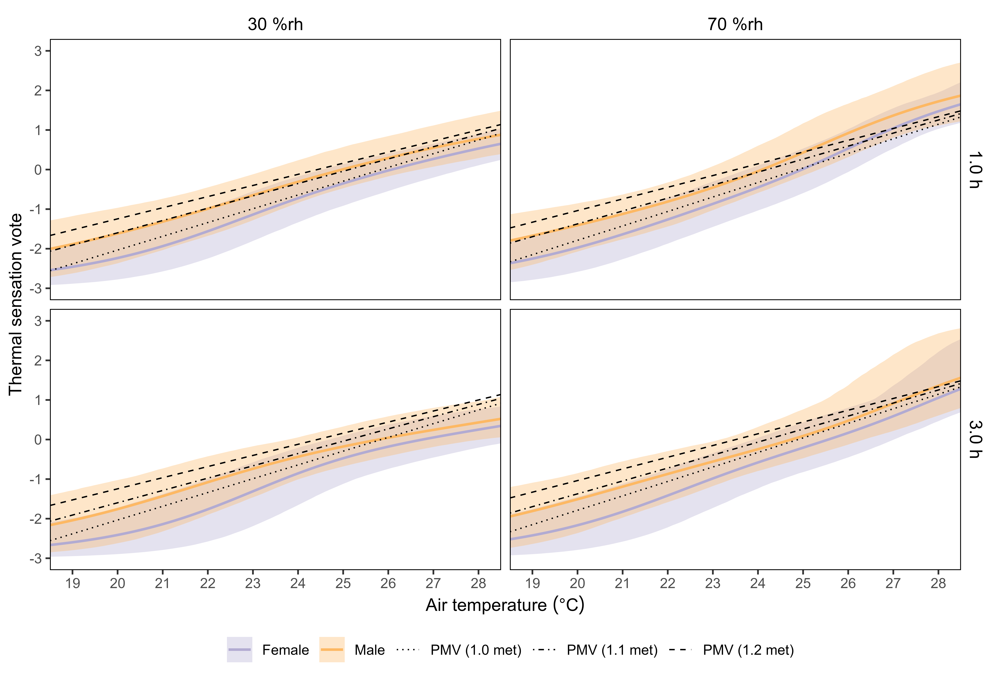
```

### Fig. S3

Posterior expected TSV as a function of air temperature under two relative humidity conditions and two exposure durations (calculated by fixing the time of day to evening and marginalising over varying effects across experimental groups).

```{r}
#| label: fig-supp-expected-TSV-temperature-evening
#| fig-cap: "Fig. S3. Posterior expected TSV as a function of air temperature under two relative humidity conditions (30% and 70%) and two exposure durations (1.0 and 3.0 h). Solid coloured lines represent posterior mean UWTDI estimates for females (violet) and males (orange), with shaded bands indicating the corresponding 95% credible intervals, calculated by fixing the time of day to evening. Black dotted, dot-dashed, and dashed lines denote PPD for metabolic rates of 1.0, 1.1, and 1.2 met, respectively." 
#| out-width: "100%"
#| echo: false

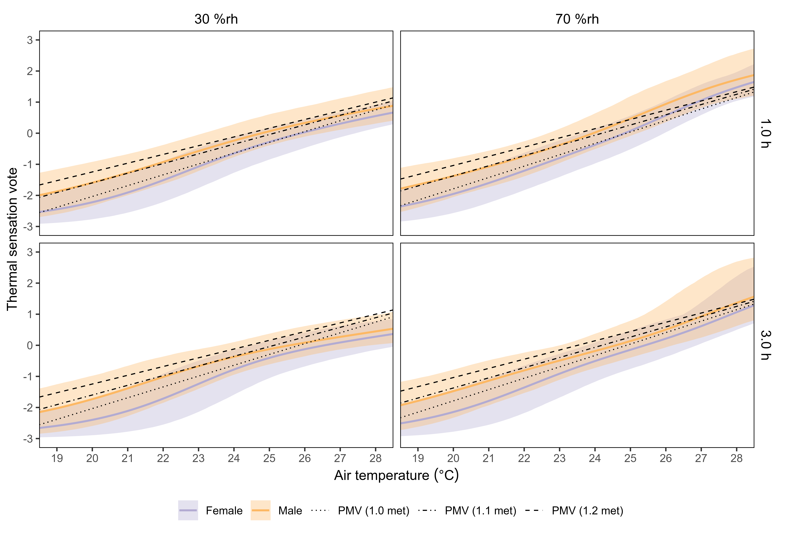
```

### Fig. S4

Posterior predictive probabilities of TSV categories across exposure duration (calculated by fixing the time of day to evening and marginalising over varying effects across experimental groups).

```{r}
#| label: fig-supp-sex-specific-prediction-evening
#| fig-cap: "Fig. S4. Posterior predictive probabilities of TSV categories across exposure duration. Posterior predictive probabilities (posterior mean and 95% credible intervals) are shown for TSV categories ranging from --3 ('cold') to +3 ('hot') as a function of exposure duration (1.0, 2.0, and 3.0 h after intervention onset). Results are stratified by biological sex (males, top rows; females, bottom rows) and environmental condition. a) Heating intervention (25.0 °C to 23.5 °C at 35% relative humidity). b) Cooling intervention (24.5 °C to 26.0 °C at 55% relative humidity)." 
#| out-width: "100%"
#| echo: false

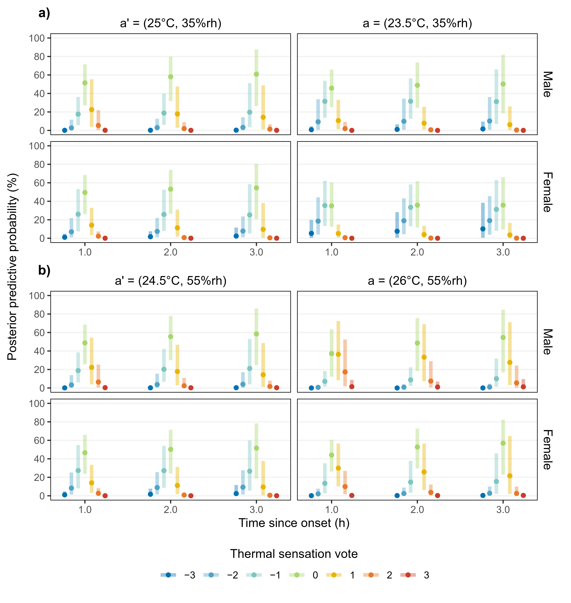
```

### Fig. S5

Conditional average treatment effects (CATEs) of temperature interventions on TSV probabilities by sex (calculated by fixing the time of day to evening and marginalising over varying effects across experimental groups).

```{r}
#| label: fig-supp-sex-specific-CATE-evening
#| fig-cap: "Fig. S5. Conditional average treatment effects (CATEs) of temperature interventions on TSV probabilities by sex. Posterior mean causal risk differences and 95% credible intervals are shown for TSV categories under hypothetical temperature  interventions across exposure duration (1.0, 2.0, and 3.0 h after  intervention onset). a) Sex-stratified CATEs for the heating  intervention (25.0 °C to 23.5 °C at 35% relative humidity). b)  Male--female differences in CATEs for heating intervention,  representing effect modification on the additive (risk-difference)  scale. c) Sex-stratified CATEs for the cooling intervention  (24.5 °C to 26.0 °C at 55% relative humidity). d) Male--female  differences in CATEs for cooling intervention, representing effect  modification on the additive (risk-difference) scale." 
#| out-width: "100%"
#| echo: false

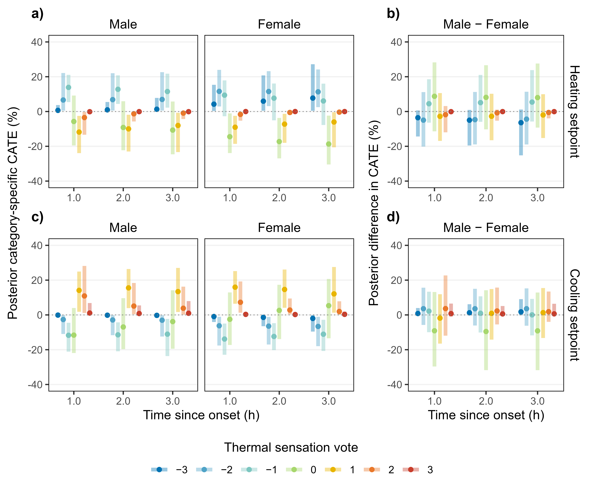
```

### Fig. S6

Posterior predictive probabilities of TSV categories across exposure duration (calculated by fixing biological sex to male and marginalising over varying effects across experimental groups).

```{r}
#| label: fig-supp-day-specific-prediction-male
#| fig-cap: "Fig. S6. Posterior predictive probabilities of TSV categories across exposure duration. Posterior predictive probabilities (posterior mean and 95% credible intervals) are shown for TSV categories ranging from --3 ('cold') to +3 ('hot') as a function of exposure duration (1.0, 2.0, and 3.0 h after intervention onset). Results are stratified by time of day (afternoon, top rows; evening, bottom rows) and environmental condition. a) Heating intervention (25.0 °C to 23.5 °C at 35% relative humidity). b) Cooling intervention (24.5 °C to 26.0 °C at 55% relative humidity)." 
#| out-width: "100%"
#| echo: false

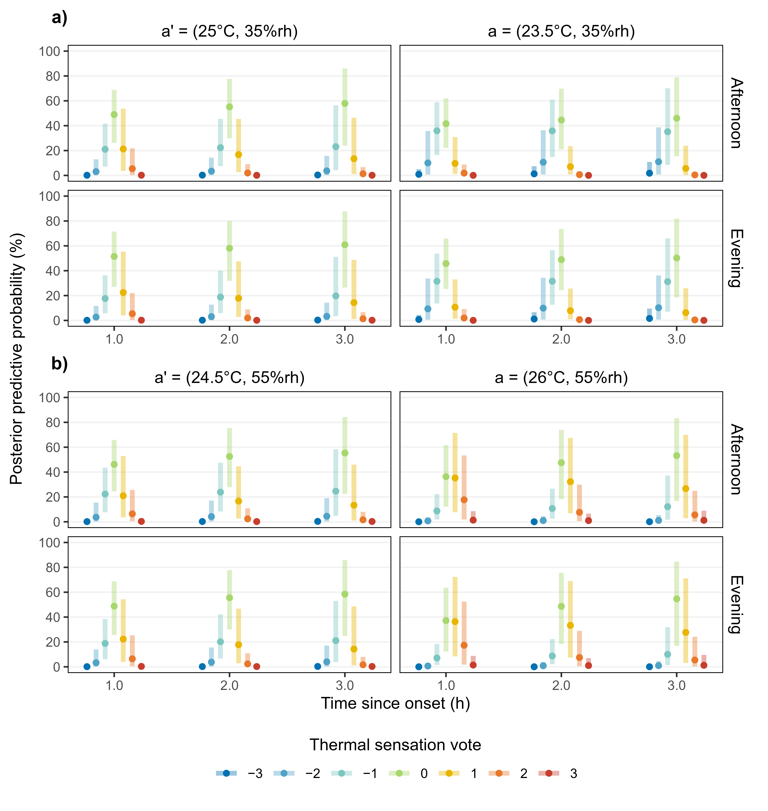
```

### Fig. S7

Posterior predictive probabilities of TSV categories across exposure duration (calculated by fixing biological sex to female and marginalising over varying effects across experimental groups).

```{r}
#| label: fig-supp-day-specific-prediction-female
#| fig-cap: "Fig. S7. Posterior predictive probabilities of TSV categories across exposure duration. Posterior predictive probabilities (posterior mean and 95% credible intervals) are shown for TSV categories ranging from --3 ('cold') to +3 ('hot') as a function of exposure duration (1.0, 2.0, and 3.0 h after intervention onset). Results are stratified by time of day (afternoon, top rows; evening, bottom rows) and environmental condition. a) Heating intervention (25.0 °C to 23.5 °C at 35% relative humidity). b) Cooling intervention (24.5 °C to 26.0 °C at 55% relative humidity)." 
#| out-width: "100%"
#| echo: false

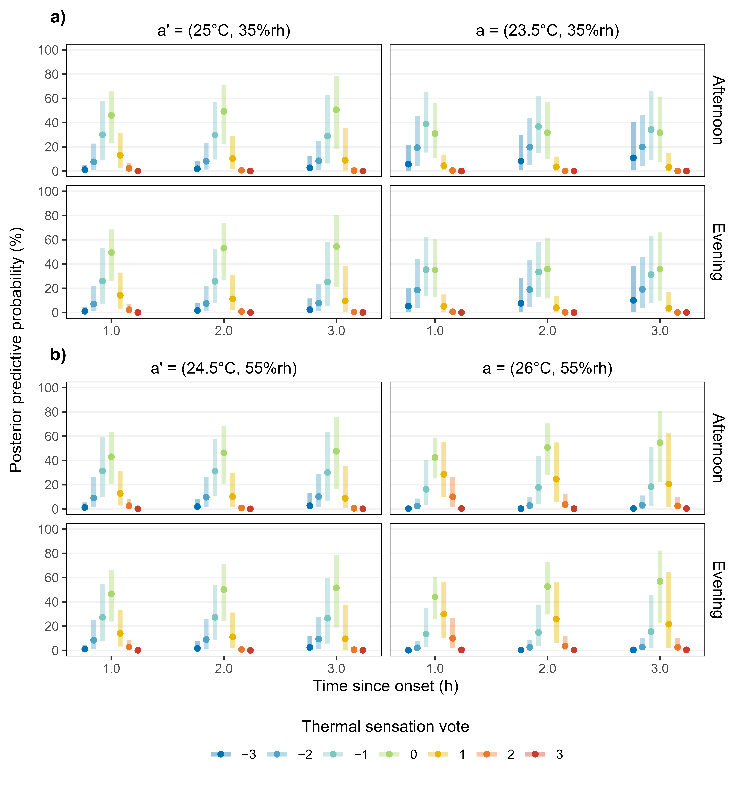
```

### Fig. S8

Conditional average treatment effects (CATEs) of temperature interventions on TSV probabilities by time of day (calculated by fixing biological sex to female and marginalising over varying effects across experimental groups).

```{r}
#| label: fig-supp-day-specific-CATE-female
#| fig-cap: "Fig. S8. Conditional average treatment effects (CATEs) of temperature interventions on TSV probabilities by time of day. Posterior mean causal risk differences and 95% credible intervals are shown for TSV categories under hypothetical temperature interventions across exposure duration (1.0, 2.0, and 3.0 h after  intervention onset). a) Time-of-day-stratified CATEs for the  heating intervention (25.0 °C to 23.5 °C at 35% relative humidity). b) Afternoon--evening differences in CATEs for heating  intervention, representing effect modification on the additive  (risk-difference) scale. c) Time-of-day-stratified CATEs for the  cooling intervention (24.5 °C to 26.0 °C at 55% relative humidity). d) Afternoon--evening differences in CATEs for cooling intervention, representing effect modification on the additive (risk-difference) scale."
#| out-width: "100%"
#| echo: false


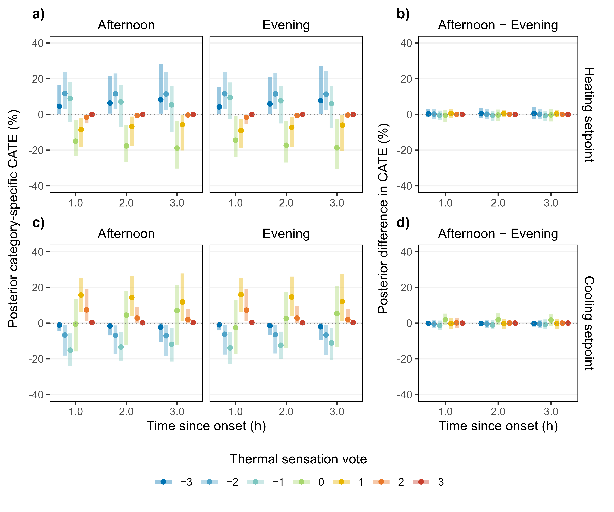
```

### Fig. S9

Posterior utility-weighted thermal dissatisfaction index (UWTDI) under alternative weighting schemes (calculated by fixing the time of day to evening and marginalising over varying effects across experimental groups).

```{r}
#| label: fig-UWTDI-temperature-evening 
#| fig-cap: "Fig. S9. Posterior utility-weighted thermal dissatisfaction index (UWTDI) under alternative weighting schemes. Posterior UWTDI is shown as a function of air temperature for the Fanger, Comfort, and Symmetric weighting schemes under two relative humidity conditions (30% and 70%) and two exposure durations (1.0 and 3.0 h). Solid coloured lines represent posterior mean UWTDI estimates for females (violet) and males (orange), with shaded bands indicating the corresponding 95% credible intervals. Black dotted, dot-dashed, and dashed lines denote PPD for metabolic rates of 1.0, 1.1, and 1.2 met, respectively. The grey horizontal dotted line marks a UWTDI of 20%, corresponding to the conventional thermal comfort criterion."
#| out-width: "60%"
#| echo: false


```

### Fig. S10

Posterior expected utility-weighted thermal dissatisfaction index (UWTDI) under setpoint interventions using Fanger scheme (calculated by fixing the time of day to evening and marginalising over varying effects across experimental groups).

```{r}
#| label: fig-UWTDI-heatmap-Fanger-evening
#| fig-cap: "Fig. S10. Posterior expected utility-weighted thermal dissatisfaction index (UWTDI) under setpoint interventions. Contours show posterior mean UWTDI under the Fanger weighting scheme as a function of air temperature and relative humidity. Red arrows indicate heating interventions (reductions in heating setpoint), whereas blue arrows indicate cooling interventions (increases in cooling setpoint). Annotated values give the posterior mean UWTDI before and after each intervention for male and female occupants across different exposure durations."
#| out-width: "90%"
#| echo: false

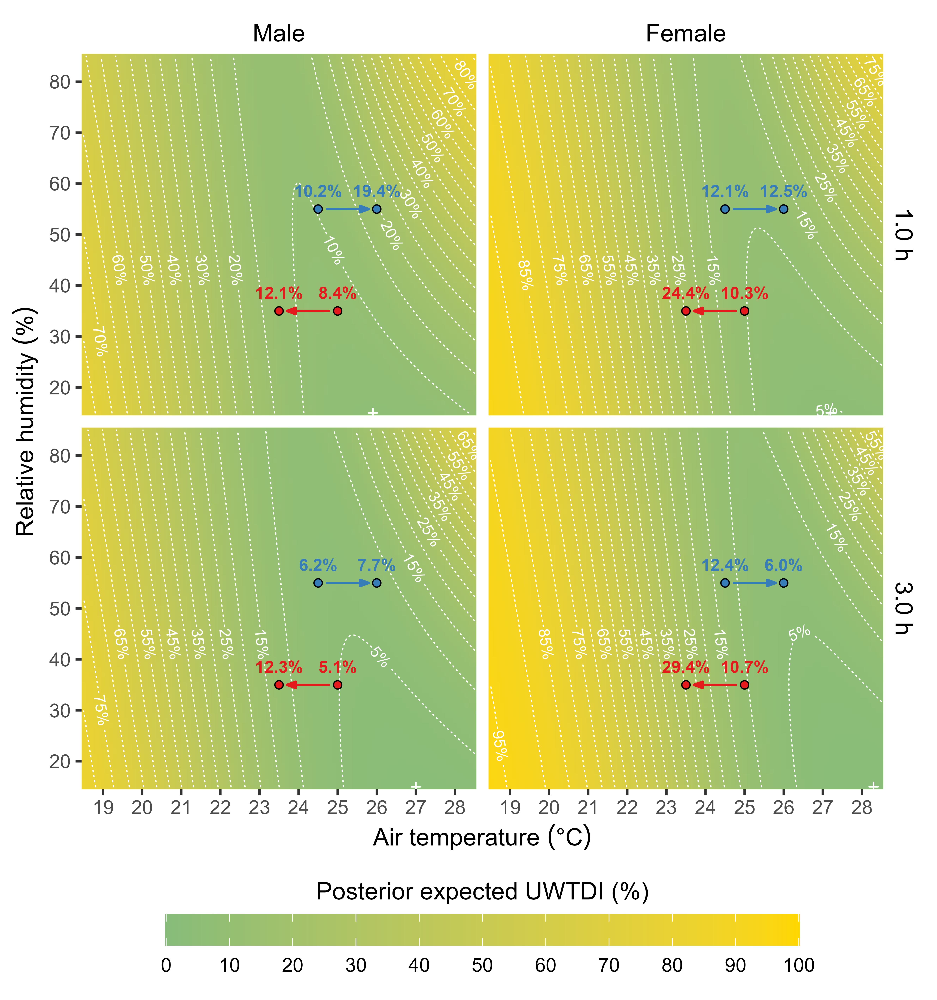
```

### Fig. S11

Posterior expected utility-weighted thermal dissatisfaction index (UWTDI) under setpoint interventions using Fanger scheme (calculated by fixing the biological sex to male and marginalising over varying effects across experimental groups).

```{r}
#| label: fig-UWTDI-heatmap-Fanger-male
#| fig-cap: "Fig. S11. Posterior expected utility-weighted thermal dissatisfaction index (UWTDI) under setpoint interventions. Contours show posterior mean UWTDI under the Fanger weighting scheme as a function of air temperature and relative humidity. Red arrows indicate heating interventions (reductions in heating setpoint), whereas blue arrows indicate cooling interventions (increases in cooling setpoint). Annotated values give the posterior mean UWTDI before and after each intervention for afternoon and evening across different exposure durations."
#| out-width: "90%"
#| echo: false

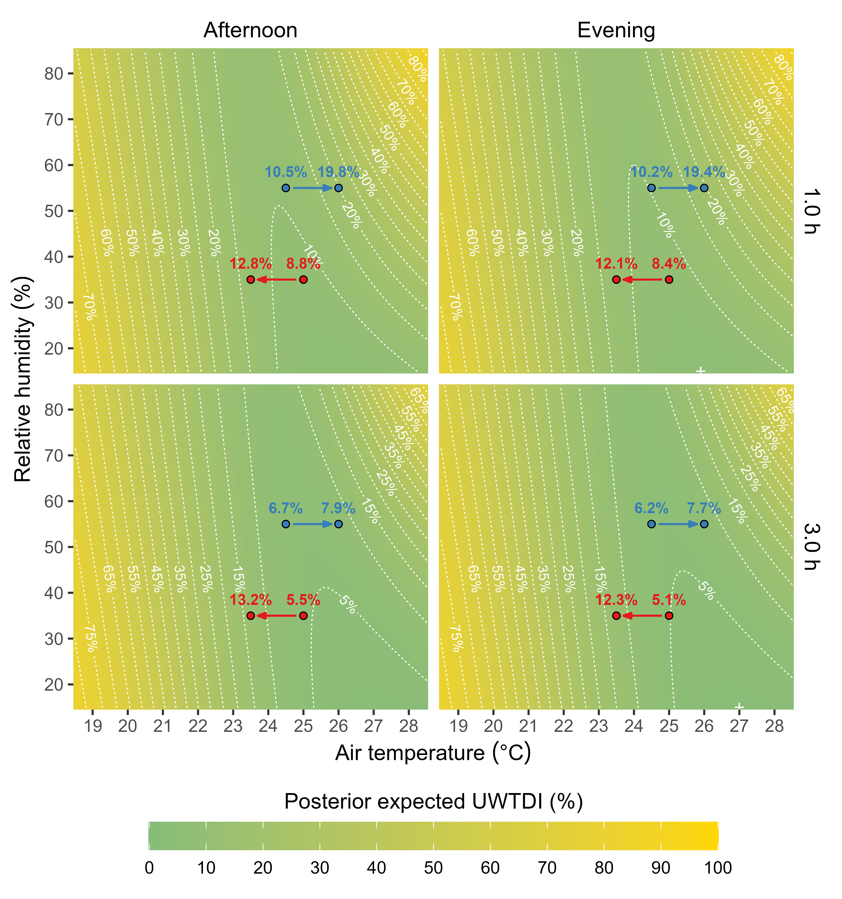
```

### Fig. S12

Posterior expected utility-weighted thermal dissatisfaction index (UWTDI) under setpoint interventions using Fanger scheme (calculated by fixing the biological sex to female and marginalising over varying effects across experimental groups).

```{r}
#| label: fig-UWTDI-heatmap-Fanger-female
#| fig-cap: "Fig. S12. Posterior expected utility-weighted thermal dissatisfaction index (UWTDI) under setpoint interventions. Contours show posterior mean UWTDI under the Fanger weighting scheme as a function of air temperature and relative humidity. Red arrows indicate heating interventions (reductions in heating setpoint), whereas blue arrows indicate cooling interventions (increases in cooling setpoint). Annotated values give the posterior mean UWTDI before and after each intervention for afternoon and evening across different exposure durations."
#| out-width: "90%"
#| echo: false

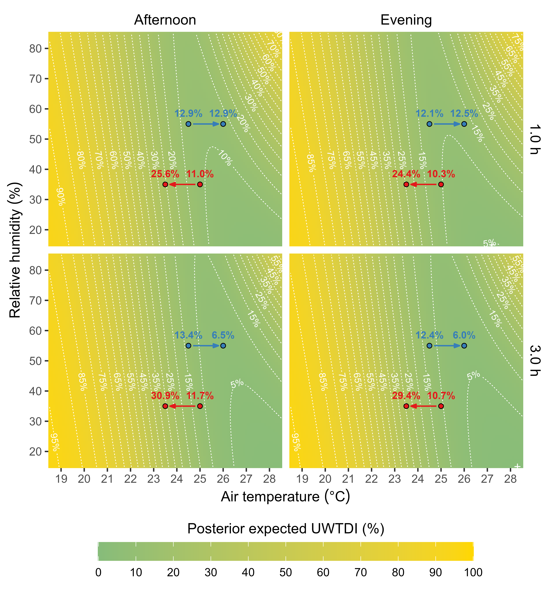
```

### Fig. S13

Posterior expected utility-weighted thermal dissatisfaction index (UWTDI) under setpoint interventions using Comfort scheme (calculated by fixing the time of day to afternoon and marginalising over varying effects across experimental groups).

```{r}
#| label: fig-UWTDI-heatmap-Comfort-afternoon
#| fig-cap: "Fig. S13. Posterior expected utility-weighted thermal dissatisfaction index (UWTDI) under setpoint interventions. Contours show posterior mean UWTDI under the Comfort weighting scheme as a function of air temperature and relative humidity. Red arrows indicate heating interventions (reductions in heating setpoint), whereas blue arrows indicate cooling interventions (increases in cooling setpoint). Annotated values give the posterior mean UWTDI before and after each intervention for male and female occupants across different exposure durations."
#| out-width: "90%"
#| echo: false


```

### Fig. S14

Posterior expected utility-weighted thermal dissatisfaction index (UWTDI) under setpoint interventions using Comfort scheme (calculated by fixing the time of day to evening and marginalising over varying effects across experimental groups).

```{r}
#| label: fig-UWTDI-heatmap-Comfort-evening
#| fig-cap: "Fig. S14. Posterior expected utility-weighted thermal dissatisfaction index (UWTDI) under setpoint interventions. Contours show posterior mean UWTDI under the Comfort weighting scheme as a function of air temperature and relative humidity. Red arrows indicate heating interventions (reductions in heating setpoint), whereas blue arrows indicate cooling interventions (increases in cooling setpoint). Annotated values give the posterior mean UWTDI before and after each intervention for male and female occupants across different exposure durations."
#| out-width: "90%"
#| echo: false

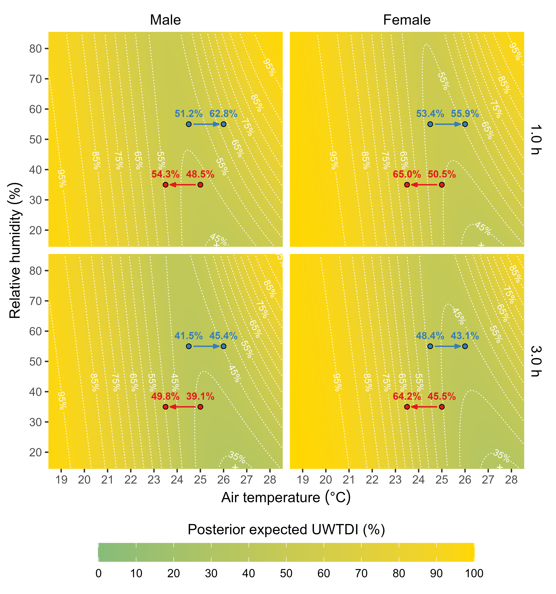
```

### Fig. S15

Posterior expected utility-weighted thermal dissatisfaction index (UWTDI) under setpoint interventions using Comfort scheme (calculated by fixing the biological sex to male and marginalising over varying effects across experimental groups).

```{r}
#| label: fig-UWTDI-heatmap-Comfort-male
#| fig-cap: "Fig. S15. Posterior expected utility-weighted thermal dissatisfaction index (UWTDI) under setpoint interventions. Contours show posterior mean UWTDI under the Comfort weighting scheme as a function of air temperature and relative humidity. Red arrows indicate heating interventions (reductions in heating setpoint), whereas blue arrows indicate cooling interventions (increases in cooling setpoint). Annotated values give the posterior mean UWTDI before and after each intervention for afternoon and evening across different exposure durations."
#| out-width: "90%"
#| echo: false

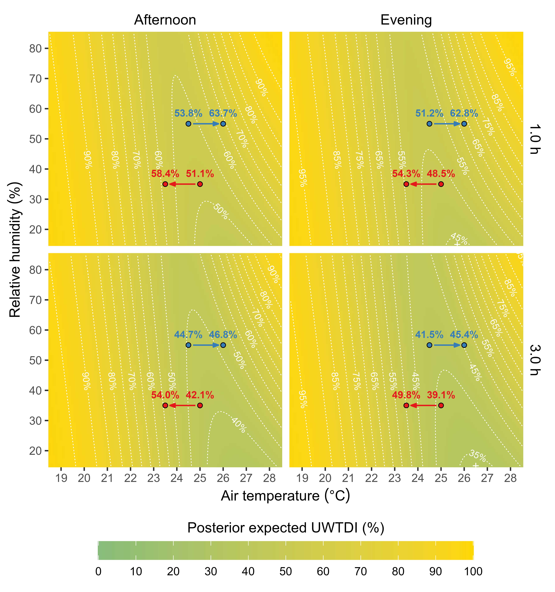
```

### Fig. S16

Posterior expected utility-weighted thermal dissatisfaction index (UWTDI) under setpoint interventions using Comfort scheme (calculated by fixing the biological sex to female and marginalising over varying effects across experimental groups).

```{r}
#| label: fig-UWTDI-heatmap-Comfort-female
#| fig-cap: "Fig. S16. Posterior expected utility-weighted thermal dissatisfaction index (UWTDI) under setpoint interventions. Contours show posterior mean UWTDI under the Comfort weighting scheme as a function of air temperature and relative humidity. Red arrows indicate heating interventions (reductions in heating setpoint), whereas blue arrows indicate cooling interventions (increases in cooling setpoint). Annotated values give the posterior mean UWTDI before and after each intervention for afternoon and evening across different exposure durations."
#| out-width: "90%"
#| echo: false

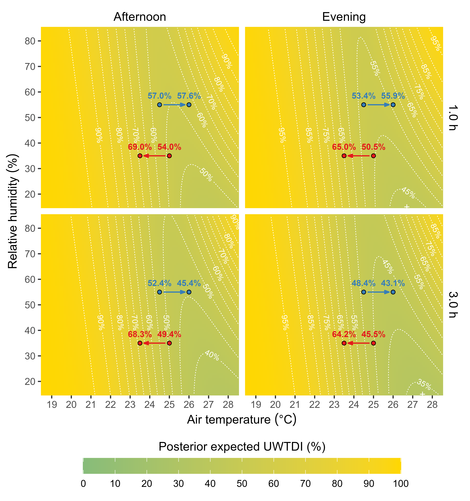
```

### Fig. S17

Posterior expected utility-weighted thermal dissatisfaction index (UWTDI) under setpoint interventions using Symmetric scheme (calculated by fixing the time of day to afternoon and marginalising over varying effects across experimental groups).

```{r}
#| label: fig-UWTDI-heatmap-Symmetric-afternoon
#| fig-cap: "Fig. S17. Posterior expected utility-weighted thermal dissatisfaction index (UWTDI) under setpoint interventions. Contours show posterior mean UWTDI under the Symmetric weighting scheme as a function of air temperature and relative humidity. Red arrows indicate heating interventions (reductions in heating setpoint), whereas blue arrows indicate cooling interventions (increases in cooling setpoint). Annotated values give the posterior mean UWTDI before and after each intervention for male and female occupants across different exposure durations."
#| out-width: "90%"
#| echo: false


```

### Fig. S18

Posterior expected utility-weighted thermal dissatisfaction index (UWTDI) under setpoint interventions using Symmetric scheme (calculated by fixing the time of day to evening and marginalising over varying effects across experimental groups).

```{r}
#| label: fig-UWTDI-heatmap-Symmetric-evening
#| fig-cap: "Fig. S18. Posterior expected utility-weighted thermal dissatisfaction index (UWTDI) under setpoint interventions. Contours show posterior mean UWTDI under the Symmetric weighting scheme as a function of air temperature and relative humidity. Red arrows indicate heating interventions (reductions in heating setpoint), whereas blue arrows indicate cooling interventions (increases in cooling setpoint). Annotated values give the posterior mean UWTDI before and after each intervention for male and female occupants across different exposure durations."
#| out-width: "90%"
#| echo: false

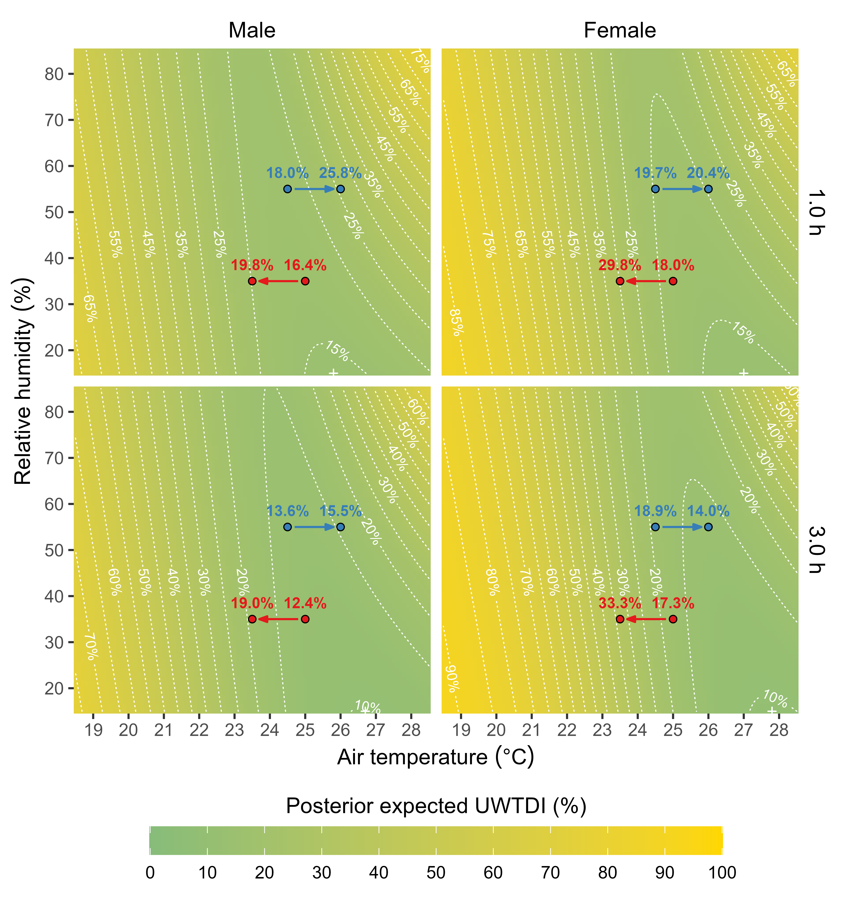
```

### Fig. S19

Posterior expected utility-weighted thermal dissatisfaction index (UWTDI) under setpoint interventions using Symmetric scheme (calculated by fixing the biological sex to male and marginalising over varying effects across experimental groups).

```{r}
#| label: fig-UWTDI-heatmap-Symmetric-male
#| fig-cap: "Fig. S19. Posterior expected utility-weighted thermal dissatisfaction index (UWTDI) under setpoint interventions. Contours show posterior mean UWTDI under the Symmetric weighting scheme as a function of air temperature and relative humidity. Red arrows indicate heating interventions (reductions in heating setpoint), whereas blue arrows indicate cooling interventions (increases in cooling setpoint). Annotated values give the posterior mean UWTDI before and after each intervention for afternoon and evening across different exposure durations."
#| out-width: "90%"
#| echo: false

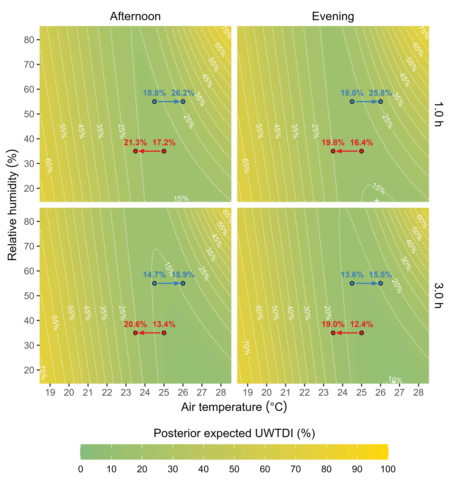
```

### Fig. S20

Posterior expected utility-weighted thermal dissatisfaction index (UWTDI) under setpoint interventions using Symmetric scheme (calculated by fixing the biological sex to female and marginalising over varying effects across experimental groups).

```{r}
#| label: fig-UWTDI-heatmap-Symmetric-female
#| fig-cap: "Fig. S20. Posterior expected utility-weighted thermal dissatisfaction index (UWTDI) under setpoint interventions. Contours show posterior mean UWTDI under the Symmetric weighting scheme as a function of air temperature and relative humidity. Red arrows indicate heating interventions (reductions in heating setpoint), whereas blue arrows indicate cooling interventions (increases in cooling setpoint). Annotated values give the posterior mean UWTDI before and after each intervention for afternoon and evening across different exposure durations."
#| out-width: "90%"
#| echo: false

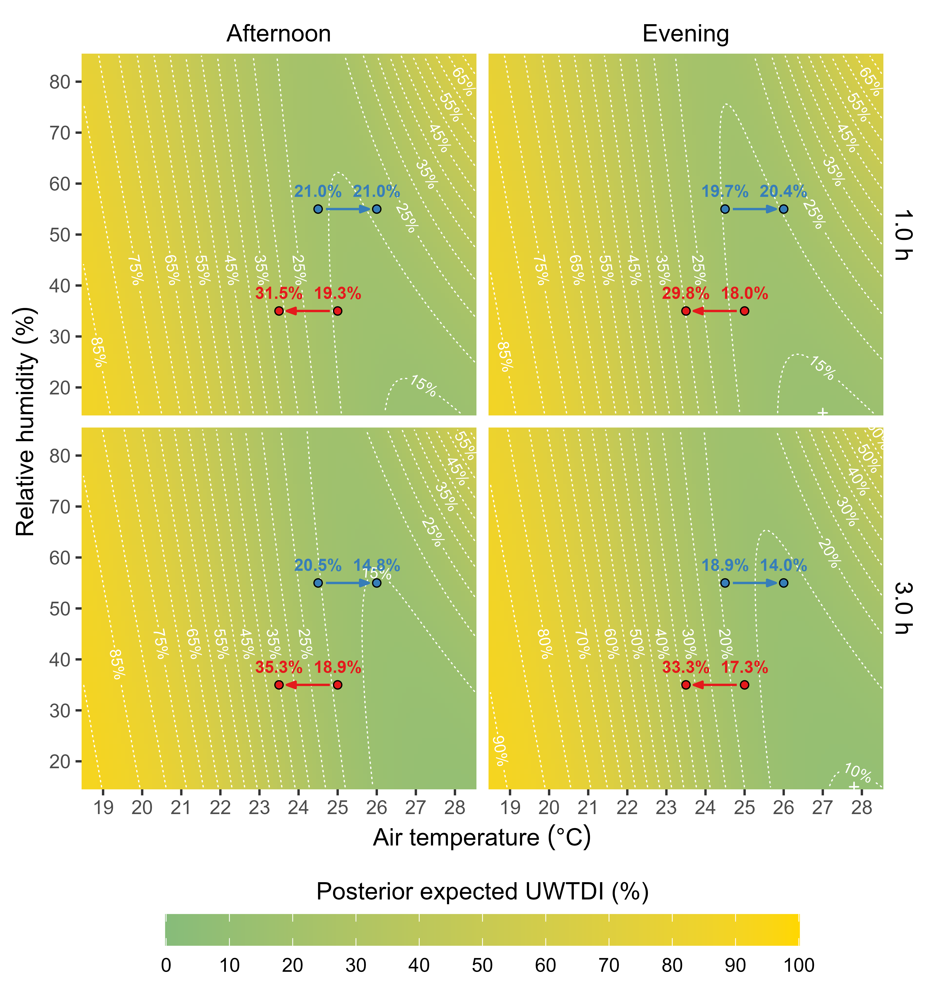
```

### Fig. S21

Posterior distributions of the utility-weighted thermal dissatisfaction index (UWTDI) under setpoint interventions using Fanger scheme (calculated by fixing the time of day to evening and marginalising over varying effects across experimental groups).

```{r}
#| label: fig-UWTDI-distribution-Fanger-evening
#| fig-cap: "Fig. S21. Posterior distributions of the utility-weighted thermal dissatisfaction index (UWTDI) under setpoint interventions. Posterior distributions of UWTDI are shown separately for females (violet) and males (orange) at 1.0, 2.0, and 3.0 h after intervention onset. For the heating intervention (top), the thermostat setpoint was reduced from $a'$ (25.0 °C, 35% relative humidity) to $a$ (23.5 °C, 35% relative humidity). For the cooling intervention (bottom), the thermostat setpoint was increased from $a'$ (24.5 °C, 55% relative humidity) to $a$ (26.0 °C, 55% relative humidity). The left and middle columns show the posterior distributions under the baseline ($a'$) and intervention ($a$) setpoints, respectively, whereas the right column shows the posterior distribution of the counterfactual contrast ($a - a'$), representing the estimated change in UWTDI attributable to the intervention. Positive values indicate an increase in UWTDI under the intervention relative to baseline, whereas negative values indicate a decrease. Vertical dotted lines indicate the reference value of 20% UWTDI (left and middle columns) and zero difference (right column), while the vertical ticks at the bottom of the plot represent the distribution means."
#| out-width: "90%"
#| echo: false

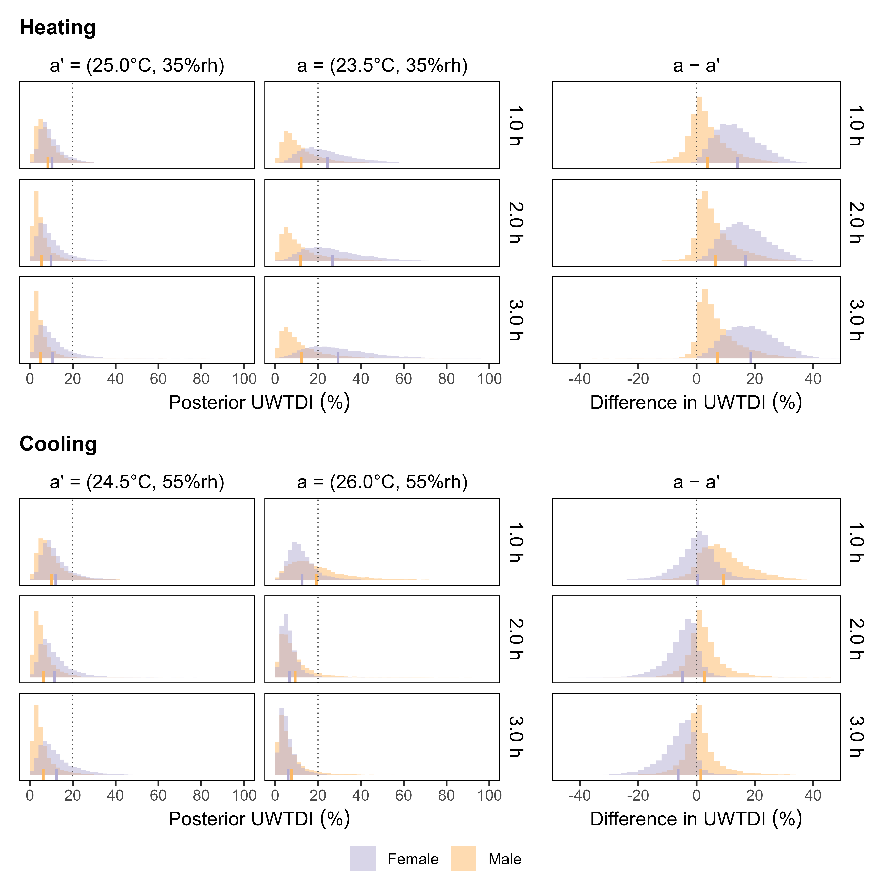
```

### Fig. S22

Posterior distributions of the utility-weighted thermal dissatisfaction index (UWTDI) under setpoint interventions using Comfort scheme (calculated by fixing the time of day to afternoon and marginalising over varying effects across experimental groups).

```{r}
#| label: fig-UWTDI-distribution-Comfort-afternoon
#| fig-cap: "Fig. S22. Posterior distributions of the utility-weighted thermal dissatisfaction index (UWTDI) under setpoint interventions. Posterior distributions of UWTDI are shown separately for females (violet) and males (orange) at 1.0, 2.0, and 3.0 h after intervention onset. For the heating intervention (top), the thermostat setpoint was reduced from $a'$ (25.0 °C, 35% relative humidity) to $a$ (23.5 °C, 35% relative humidity). For the cooling intervention (bottom), the thermostat setpoint was increased from $a'$ (24.5 °C, 55% relative humidity) to $a$ (26.0 °C, 55% relative humidity). The left and middle columns show the posterior distributions under the baseline ($a'$) and intervention ($a$) setpoints, respectively, whereas the right column shows the posterior distribution of the counterfactual contrast ($a - a'$), representing the estimated change in UWTDI attributable to the intervention. Positive values indicate an increase in UWTDI under the intervention relative to baseline, whereas negative values indicate a decrease. Vertical dotted lines indicate the reference value of 20% UWTDI (left and middle columns) and zero difference (right column), while the vertical ticks at the bottom of the plot represent the distribution means."
#| out-width: "90%"
#| echo: false

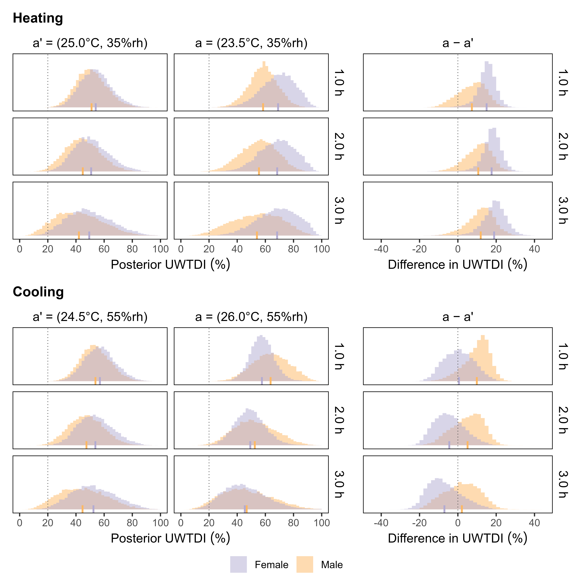
```

### Fig. S23

Posterior distributions of the utility-weighted thermal dissatisfaction index (UWTDI) under setpoint interventions using Comfort scheme (calculated by fixing the time of day to evening and marginalising over varying effects across experimental groups).

```{r}
#| label: fig-UWTDI-distribution-Comfort-evening
#| fig-cap: "Fig. S23. Posterior distributions of the utility-weighted thermal dissatisfaction index (UWTDI) under setpoint interventions. Posterior distributions of UWTDI are shown separately for females (violet) and males (orange) at 1.0, 2.0, and 3.0 h after intervention onset. For the heating intervention (top), the thermostat setpoint was reduced from $a'$ (25.0 °C, 35% relative humidity) to $a$ (23.5 °C, 35% relative humidity). For the cooling intervention (bottom), the thermostat setpoint was increased from $a'$ (24.5 °C, 55% relative humidity) to $a$ (26.0 °C, 55% relative humidity). The left and middle columns show the posterior distributions under the baseline ($a'$) and intervention ($a$) setpoints, respectively, whereas the right column shows the posterior distribution of the counterfactual contrast ($a - a'$), representing the estimated change in UWTDI attributable to the intervention. Positive values indicate an increase in UWTDI under the intervention relative to baseline, whereas negative values indicate a decrease. Vertical dotted lines indicate the reference value of 20% UWTDI (left and middle columns) and zero difference (right column), while the vertical ticks at the bottom of the plot represent the distribution means."
#| out-width: "90%"
#| echo: false

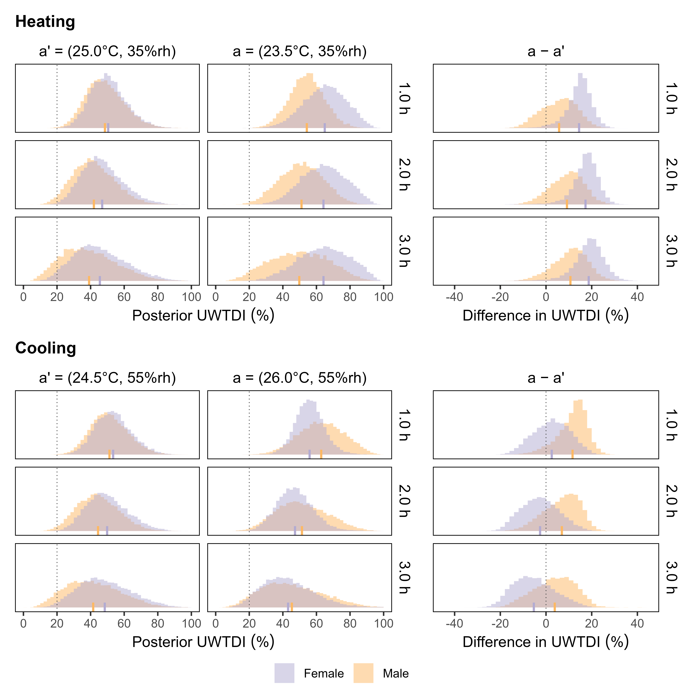
```

### Fig. S24

Posterior distributions of the utility-weighted thermal dissatisfaction index (UWTDI) under setpoint interventions using Symmetric scheme (calculated by fixing the time of day to afternoon and marginalising over varying effects across experimental groups).

```{r}
#| label: fig-UWTDI-distribution-Symmetric-afternoon
#| fig-cap: "Fig. S24. Posterior distributions of the utility-weighted thermal dissatisfaction index (UWTDI) under setpoint interventions. Posterior distributions of UWTDI are shown separately for females (violet) and males (orange) at 1.0, 2.0, and 3.0 h after intervention onset. For the heating intervention (top), the thermostat setpoint was reduced from $a'$ (25.0 °C, 35% relative humidity) to $a$ (23.5 °C, 35% relative humidity). For the cooling intervention (bottom), the thermostat setpoint was increased from $a'$ (24.5 °C, 55% relative humidity) to $a$ (26.0 °C, 55% relative humidity). The left and middle columns show the posterior distributions under the baseline ($a'$) and intervention ($a$) setpoints, respectively, whereas the right column shows the posterior distribution of the counterfactual contrast ($a - a'$), representing the estimated change in UWTDI attributable to the intervention. Positive values indicate an increase in UWTDI under the intervention relative to baseline, whereas negative values indicate a decrease. Vertical dotted lines indicate the reference value of 20% UWTDI (left and middle columns) and zero difference (right column), while the vertical ticks at the bottom of the plot represent the distribution means."
#| out-width: "90%"
#| echo: false

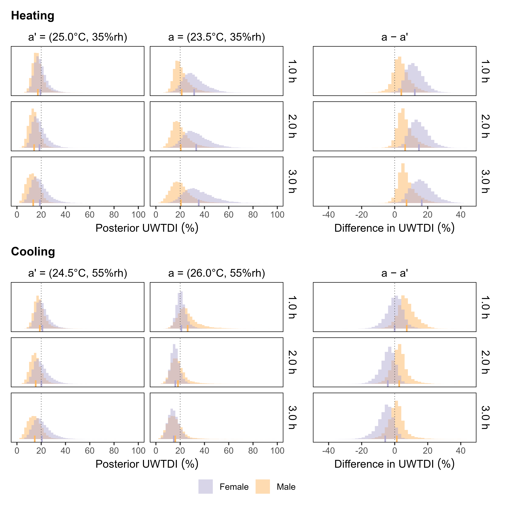
```

### Fig. S25

Posterior distributions of the utility-weighted thermal dissatisfaction index (UWTDI) under setpoint interventions using Symmetric scheme (calculated by fixing the time of day to evening and marginalising over varying effects across experimental groups).

```{r}
#| label: fig-UWTDI-distribution-Symmetric-evening
#| fig-cap: "Fig. S25. Posterior distributions of the utility-weighted thermal dissatisfaction index (UWTDI) under setpoint interventions. Posterior distributions of UWTDI are shown separately for females (violet) and males (orange) at 1.0, 2.0, and 3.0 h after intervention onset. For the heating intervention (top), the thermostat setpoint was reduced from $a'$ (25.0 °C, 35% relative humidity) to $a$ (23.5 °C, 35% relative humidity). For the cooling intervention (bottom), the thermostat setpoint was increased from $a'$ (24.5 °C, 55% relative humidity) to $a$ (26.0 °C, 55% relative humidity). The left and middle columns show the posterior distributions under the baseline ($a'$) and intervention ($a$) setpoints, respectively, whereas the right column shows the posterior distribution of the counterfactual contrast ($a - a'$), representing the estimated change in UWTDI attributable to the intervention. Positive values indicate an increase in UWTDI under the intervention relative to baseline, whereas negative values indicate a decrease. Vertical dotted lines indicate the reference value of 20% UWTDI (left and middle columns) and zero difference (right column), while the vertical ticks at the bottom of the plot represent the distribution means."
#| out-width: "90%"
#| echo: false

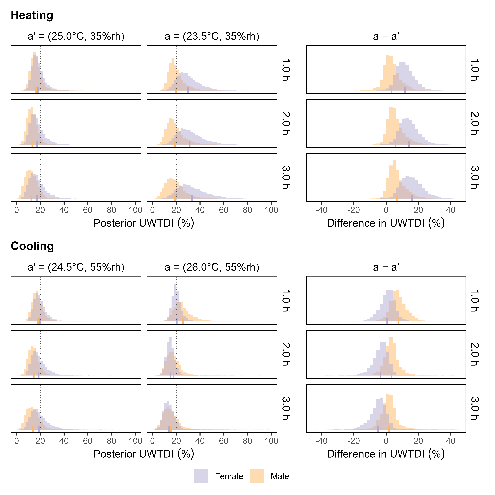
```

# Tables

```{r}
# Load packages
suppressPackageStartupMessages({
  library(knitr)
  library(tidyverse)
  library(kableExtra)
})
```

### Table S1

Posterior predictive probabilities (posterior mean and 95% credible intervals) of TSV categories for heating intervention. All predictions are marginalising over varying effects across experimental groups.

```{r}
#| label: tbl-supp-risk-prediction-heating
#| tbl-cap: "Posterior predictive probabilities (posterior mean and 95% credible intervals) of TSV categories for heating intervention. All predictions are marginalising over varying effects across experimental groups."
#| echo: false
#| output: true
#| message: false

table_1 <- read.csv("tables/risk.pred_heating_23.5t35rh_25t35rh.csv") %>%
  select(-c(".width", ".point", ".interval", "facet_setpoint")) %>%
  mutate(rel.hum = sprintf("%.1f", rel.hum),
         prob = sprintf("%.1f", prob* 100),
         .lower = sprintf("%.1f", .lower* 100),
         .upper = sprintf("%.1f", .upper* 100),
         `Estimate 95_Cr` = paste(prob, " [", .lower, ", ", .upper, "]", sep = "")) %>%
  select(-c(prob, .lower, .upper))

kable(table_1,
      col.names = c("T air (°C)", "RH\u00A0(%)", "Sex", "Onset", "Time of day", "TSV", "Estimate [95% CrI] (%)"), 
      align = "c") %>%
  kable_styling(full_width = TRUE) %>%
  scroll_box(height = "400px")


```

### Table S2

Posterior predictive probabilities (posterior mean and 95% credible intervals) of TSV categories for cooling intervention. All predictions are marginalising over varying effects across experimental groups.

```{r}
#| label: tbl-supp-risk-prediction-cooling
#| tbl-cap: "Posterior predictive probabilities (posterior mean and 95% credible intervals) of TSV categories for cooling intervention. All predictions are marginalising over varying effects across experimental groups."
#| echo: false
#| output: true
#| message: false

table_2 <- read.csv("tables/risk.pred_cooling_26t55rh_24.5t55rh.csv") %>%
  select(-c(".width", ".point", ".interval", "facet_setpoint")) %>%
  mutate(rel.hum = sprintf("%.1f", rel.hum),
         prob = sprintf("%.1f", prob* 100),
         .lower = sprintf("%.1f", .lower* 100),
         .upper = sprintf("%.1f", .upper* 100),
         `Estimate 95_Cr` = paste(prob, " [", .lower, ", ", .upper, "]", sep = "")) %>%
  select(-c(prob, .lower, .upper))

kable(table_2, 
      col.names = c("T air (°C)", "RH\u00A0(%)", "Sex", "Onset", "Time of day", "TSV", "Estimate [95% CrI] (%)"), 
      align = "c") %>%
  kable_styling(full_width = TRUE) %>%
  scroll_box(height = "400px")

```

### Table S3

Posterior category-specific CATE (posterior mean and 95% credible intervals) of heating interventions on TSV. All predictions are marginalising over varying effects across experimental groups.

```{r}
#| label: tbl-supp-risk-difference-heating
#| tbl-cap: "Posterior category-specific CATE (posterior mean and 95% credible intervals) of heating interventions on TSV. All predictions are marginalising over varying effects across experimental groups."
#| echo: false
#| output: true
#| message: false

table_3 <- read.csv("tables/risk.diff_heating_23.5t35rh_25t35rh.csv") %>%
  select(-c(".width", ".point", ".interval")) %>%
  mutate(X23.5t35rh_25t35rh = sprintf("%.1f", X23.5t35rh_25t35rh* 100),
         .lower = sprintf("%.1f", .lower* 100),
         .upper = sprintf("%.1f", .upper* 100),
         `Estimate 95_Cr` = paste(X23.5t35rh_25t35rh, " [", .lower, ", ", .upper, "]", sep = "")) %>%
  select(-c(X23.5t35rh_25t35rh, .lower, .upper))

kable(table_3, 
      col.names = c("Sex", "Onset", "Time of day", "TSV", "Estimate [95% CrI] (%)"), 
      align = "c") %>%
  kable_styling(full_width = TRUE) %>%
  scroll_box(height = "400px")

```

### Table S4

Posterior probabilities of directional CATEs across TSV categories given a heating intervention. All predictions are marginalising over varying effects across experimental groups

```{r}
#| label: tbl-supp-risk-difference-heating-direction
#| tbl-cap: "Posterior probabilities of directional CATEs across TSV categories given a heating intervention. All predictions are marginalising over varying effects across experimental groups."
#| echo: false
#| output: true
#| message: false

table_4 <- read.csv("tables/risk.diff_heating_direction_23.5t35rh_25t35rh.csv") %>%
  mutate(pr_gt_0 = sprintf("%.1f", pr_gt_0* 100),
         pr_lt_0 = sprintf("%.1f", pr_lt_0* 100)) 

kable(table_4, 
      col.names = c("Sex", "Onset", "Time of day", "TSV", "Pr(CATE_k>0) (%)", "Pr(CATE_k<0) (%)"), 
      align = "c") %>%
  kable_styling(full_width = TRUE) %>%
  scroll_box(height = "400px")

```

### Table S5

Posterior category-specific CATE (posterior mean and 95% credible intervals) of cooling interventions on TSV. All predictions are marginalising over varying effects across experimental groups.

```{r}
#| label: tbl-supp-risk-difference-cooling
#| tbl-cap: "Posterior category-specific CATE (posterior mean and 95% credible intervals) of cooling interventions on TSV. All predictions are marginalising over varying effects across experimental groups."
#| echo: false
#| output: true
#| message: false

table_5 <- read.csv("tables/risk.diff_cooling_26t55rh_24.5t55rh.csv") %>%
  select(-c(".width", ".point", ".interval")) %>%
  mutate(X26t55rh_24.5t55rh = sprintf("%.1f", X26t55rh_24.5t55rh* 100),
         .lower = sprintf("%.1f", .lower* 100),
         .upper = sprintf("%.1f", .upper* 100),
         `Estimate 95_Cr` = paste(X26t55rh_24.5t55rh, " [", .lower, ", ", .upper, "]", sep = "")) %>%
  select(-c(X26t55rh_24.5t55rh, .lower, .upper))

kable(table_5, 
      col.names = c("Sex", "Onset", "Time of day", "TSV", "Estimate [95% CrI] (%)"), 
      align = "c") %>%
  kable_styling(full_width = TRUE) %>%
  scroll_box(height = "400px")

```

### Table S6

Posterior probabilities of directional CATEs across TSV categories given a cooliing intervention. All predictions are marginalising over varying effects across experimental groups.

```{r}
#| label: tbl-supp-risk-difference-cooling-direction
#| tbl-cap: "Posterior probabilities of directional CATEs across TSV categories given a cooling intervention. All predictions are marginalising over varying effects across experimental groups."
#| echo: false
#| output: true
#| message: false

table_6 <- read.csv("tables/risk.diff_cooling_direction_26t55rh_24.5t55rh.csv") %>%
  mutate(pr_gt_0 = sprintf("%.1f", pr_gt_0* 100),
         pr_lt_0 = sprintf("%.1f", pr_lt_0* 100)) 

kable(table_6, 
      col.names = c("Sex", "Onset", "Time of day", "TSV", "Pr(CATE_k>0) (%)", "Pr(CATE_k<0) (%)"), 
      align = "c") %>%
  kable_styling(full_width = TRUE) %>%
  scroll_box(height = "400px")

```

### Table S7

Posterior category-specific difference in CATE (posterior mean and 95% credible intervals) of heating interventions on TSV by sex (male--female). All predictions are marginalising over varying effects across experimental groups.

```{r}
#| label: tbl-supp-effect-modification-heating-sex
#| tbl-cap: "Posterior category-specific CATE (posterior mean and 95% credible intervals) of heating interventions on TSV by sex (male--female). All predictions are marginalising over varying effects across experimental groups."
#| echo: false
#| output: true
#| message: false

table_7 <- read.csv("tables/eff.mod_sex_heating_23.5t35rh_25t35rh.csv") %>%
  select(-c(".width", ".point", ".interval")) %>%
  mutate(EM.sex_M.F = sprintf("%.1f", EM.sex_M.F* 100),
         .lower = sprintf("%.1f", .lower* 100),
         .upper = sprintf("%.1f", .upper* 100),
         `Estimate 95_Cr` = paste(EM.sex_M.F, " [", .lower, ", ", .upper, "]", sep = "")) %>%
  select(-c(EM.sex_M.F, .lower, .upper))

kable(table_7, 
      col.names = c("Onset", "Time of day", "TSV", "Estimate [95% CrI] (%)"), 
      align = "c") %>%
  kable_styling(full_width = TRUE) %>%
  scroll_box(height = "400px")

```

### Table S8

Posterior probabilities of directional difference in CATEs across TSV categories given a heating intervention by sex (male--female). All predictions are marginalising over varying effects across experimental groups

```{r}
#| label: tbl-supp-effect-modification-heating-direction-sex
#| tbl-cap: "Posterior probabilities of directional difference in CATEs across TSV categories given a heating intervention by sex (male--female). All predictions are marginalising over varying effects across experimental groups."
#| echo: false
#| output: true
#| message: false

table_8 <- read.csv("tables/eff.mod_sex_heating_direction_23.5t35rh_25t35rh.csv") %>%
  mutate(pr_gt_0 = sprintf("%.1f", pr_gt_0* 100),
         pr_lt_0 = sprintf("%.1f", pr_lt_0* 100)) 

kable(table_8, 
      col.names = c("Onset", "Time of day", "TSV", "Pr(ΔCATE_k,m--f>0) (%)", "Pr(ΔCATE_k,m--f<0) (%)"), 
      align = "c") %>%
  kable_styling(full_width = TRUE) %>%
  scroll_box(height = "400px")

```

### Table S9

Posterior category-specific difference in CATE (posterior mean and 95% credible intervals) of cooling interventions on TSV by sex (male--female). All predictions are marginalising over varying effects across experimental groups.

```{r}
#| label: tbl-supp-effect-modification-cooling-sex
#| tbl-cap: "Posterior category-specific CATE (posterior mean and 95% credible intervals) of cooling interventions on TSV by sex (male--female). All predictions are marginalising over varying effects across experimental groups."
#| echo: false
#| output: true
#| message: false

table_9 <- read.csv("tables/eff.mod_sex_cooling_26t55rh_24.5t55rh.csv") %>%
  select(-c(".width", ".point", ".interval")) %>%
  mutate(EM.sex_M.F = sprintf("%.1f", EM.sex_M.F* 100),
         .lower = sprintf("%.1f", .lower* 100),
         .upper = sprintf("%.1f", .upper* 100),
         `Estimate 95_Cr` = paste(EM.sex_M.F, " [", .lower, ", ", .upper, "]", sep = "")) %>%
  select(-c(EM.sex_M.F, .lower, .upper))

kable(table_9, 
      col.names = c("Onset", "Time of day", "TSV", "Estimate [95% CrI] (%)"), 
      align = "c") %>%
  kable_styling(full_width = TRUE) %>%
  scroll_box(height = "400px")

```

### Table S10

Posterior probabilities of directional difference in CATEs across TSV categories given a cooling intervention by sex (male--female). All predictions are marginalising over varying effects across experimental groups

```{r}
#| label: tbl-supp-effect-modification-cooling-direction-sex
#| tbl-cap: "Posterior probabilities of directional difference in CATEs across TSV categories given a cooling intervention by sex (male--female). All predictions are marginalising over varying effects across experimental groups."
#| echo: false
#| output: true
#| message: false

table_10 <- read.csv("tables/eff.mod_sex_cooling_direction_26t55rh_24.5t55rh.csv") %>%
  mutate(pr_gt_0 = sprintf("%.1f", pr_gt_0* 100),
         pr_lt_0 = sprintf("%.1f", pr_lt_0* 100)) 

kable(table_10, 
      col.names = c("Onset", "Time of day", "TSV", "Pr(ΔCATE_k,m--f>0) (%)", "Pr(ΔCATE_k,m--f<0) (%)"), 
      align = "c") %>%
  kable_styling(full_width = TRUE) %>%
  scroll_box(height = "400px")

```

### Table S11

Posterior category-specific difference in CATE (posterior mean and 95% credible intervals) of heating interventions on TSV by time of day (afternoon--evening). All predictions are marginalising over varying effects across experimental groups.

```{r}
#| label: tbl-supp-effect-modification-heating-day
#| tbl-cap: "Posterior category-specific CATE (posterior mean and 95% credible intervals) of heating interventions on TSV by time of day (afternoon--evening). All predictions are marginalising over varying effects across experimental groups."
#| echo: false
#| output: true
#| message: false

table_11 <- read.csv("tables/eff.mod_day_heating_23.5t35rh_25t35rh.csv") %>%
  select(-c(".width", ".point", ".interval")) %>%
  mutate(EM.day_A.E = sprintf("%.1f", EM.day_A.E* 100),
         .lower = sprintf("%.1f", .lower* 100),
         .upper = sprintf("%.1f", .upper* 100),
         `Estimate 95_Cr` = paste(EM.day_A.E, " [", .lower, ", ", .upper, "]", sep = "")) %>%
  select(-c(EM.day_A.E, .lower, .upper))

kable(table_11, 
      col.names = c("Onset", "Sex", "TSV", "Estimate [95% CrI] (%)"), 
      align = "c") %>%
  kable_styling(full_width = TRUE) %>%
  scroll_box(height = "400px")

```

### Table S12

Posterior probabilities of directional difference in CATEs across TSV categories given a heating intervention by time of day (afternoon--evening). All predictions are marginalising over varying effects across experimental groups

```{r}
#| label: tbl-supp-effect-modification-heating-direction-day
#| tbl-cap: "Posterior probabilities of directional difference in CATEs across TSV categories given a heating intervention by time of day (afternoon--evening). All predictions are marginalising over varying effects across experimental groups."
#| echo: false
#| output: true
#| message: false

table_12 <- read.csv("tables/eff.mod_day_heating_direction_23.5t35rh_25t35rh.csv") %>%
  mutate(pr_gt_0 = sprintf("%.1f", pr_gt_0* 100),
         pr_lt_0 = sprintf("%.1f", pr_lt_0* 100)) 

kable(table_12, 
      col.names = c("Onset", "Sex", "TSV", "Pr(ΔCATE_k,a--e>0) (%)", "Pr(ΔCATE_k,a--e<0) (%)"), 
      align = "c") %>%
  kable_styling(full_width = TRUE) %>%
  scroll_box(height = "400px")

```

### Table S13

Posterior category-specific difference in CATE (posterior mean and 95% credible intervals) of cooling interventions on TSV by time of day (afternoon--evening). All predictions are marginalising over varying effects across experimental groups.

```{r}
#| label: tbl-supp-effect-modification-cooling-day
#| tbl-cap: "Posterior category-specific CATE (posterior mean and 95% credible intervals) of cooling interventions on TSV by time of day (afternoon--evening). All predictions are marginalising over varying effects across experimental groups."
#| echo: false
#| output: true
#| message: false

table_13 <- read.csv("tables/eff.mod_day_cooling_26t55rh_24.5t55rh.csv") %>%
  select(-c(".width", ".point", ".interval")) %>%
  mutate(EM.day_A.E = sprintf("%.1f", EM.day_A.E* 100),
         .lower = sprintf("%.1f", .lower* 100),
         .upper = sprintf("%.1f", .upper* 100),
         `Estimate 95_Cr` = paste(EM.day_A.E, " [", .lower, ", ", .upper, "]", sep = "")) %>%
  select(-c(EM.day_A.E, .lower, .upper))

kable(table_13, 
      col.names = c("Onset", "Sex", "TSV", "Estimate [95% CrI] (%)"), 
      align = "c") %>%
  kable_styling(full_width = TRUE) %>%
  scroll_box(height = "400px")

```

### Table S14

Posterior probabilities of directional difference in CATEs across TSV categories given a cooling intervention by time of day (afternoon--evening). All predictions are marginalising over varying effects across experimental groups

```{r}
#| label: tbl-supp-effect-modification-cooling-direction-day
#| tbl-cap: "Posterior probabilities of directional difference in CATEs across TSV categories given a cooling intervention by time of day (afternoon--evening). All predictions are marginalising over varying effects across experimental groups."
#| echo: false
#| output: true
#| message: false

table_14 <- read.csv("tables/eff.mod_day_cooling_direction_26t55rh_24.5t55rh.csv") %>%
  mutate(pr_gt_0 = sprintf("%.1f", pr_gt_0* 100),
         pr_lt_0 = sprintf("%.1f", pr_lt_0* 100)) 

kable(table_14, 
      col.names = c("Onset", "Sex", "TSV", "Pr(ΔCATE_k,a--e>0) (%)", "Pr(ΔCATE_k,a--e<0) (%)"), 
      align = "c") %>%
  kable_styling(full_width = TRUE) %>%
  scroll_box(height = "400px")

```

### Table S15

Posterior distributions of UWTDI under heating intervention using Fanger scheme. All predictions are marginalising over varying effects across experimental groups.

```{r}
#| label: tbl-supp-UWTDI-distribution-Fanger-heating
#| tbl-cap: "Posterior distributions of UWTDI under heating intervention using Fanger scheme. All predictions are marginalising over varying effects across experimental groups."
#| echo: false
#| output: true
#| message: false

table_15 <- read.csv("tables/Fanger_heating.intervention_summary.csv") %>%
  select(-c(".width", ".point", ".interval")) %>%
  mutate(rel.hum = sprintf("%.1f", rel.hum),
         total.cost = sprintf("%.1f", total.cost* 100),
         .lower = sprintf("%.1f", .lower* 100),
         .upper = sprintf("%.1f", .upper* 100),
         `Estimate 95_Cr` = paste(total.cost," [", .lower, ", ", .upper, "]", sep = ""),
         pr_greater20 = sprintf("%.1f", pr_greater20* 100)) %>%
  relocate(last_col(), .before = last_col(offset = 1)) %>%
  select(-c(total.cost, .lower, .upper))

kable(table_15,
      col.names = c("T\u00A0air\u00A0(°C)", "RH\u00A0(%)", "Sex", "Time\u00A0of\u00A0day", "Onset", "Estimate\u00A0[95%\u00A0CrI]\u00A0(%)", "Pr(UWTDI>20%)\u00A0(%)"), 
      align = "c") %>%
  kable_styling(full_width = TRUE) %>%
  scroll_box(height = "400px")

```

### Table S16

Posterior probabilities of directional difference in UWTDI under heating intervention using Fanger scheme. All predictions are marginalising over varying effects across experimental groups.

```{r}
#| label: tbl-supp-UWTDI-distribution-Fanger-heating-direction
#| tbl-cap: "Posterior probabilities of directional difference in UWTDI under heating intervention using Fanger scheme.All predictions are marginalising over varying effects across experimental groups."
#| echo: false
#| output: true
#| message: false

table_16 <- read.csv("tables/Fanger_heating.diff.intervention_summary.csv") %>%
  select(-c("setpoint", ".width", ".point", ".interval")) %>%
  mutate(X23.5t35rh_25t35rh = sprintf("%.1f", X23.5t35rh_25t35rh* 100),
         .lower = sprintf("%.1f", .lower* 100),
         .upper = sprintf("%.1f", .upper* 100),
         `Estimate 95_Cr` = paste(X23.5t35rh_25t35rh," [", .lower, ", ", .upper, "]", sep = ""),
         pr_greater0 = sprintf("%.1f", pr_greater0* 100)) %>%
  relocate(last_col(), .before = last_col(offset = 1)) %>%
  select(-c(X23.5t35rh_25t35rh, .lower, .upper))

kable(table_16,
      col.names = c("Sex", "Time of day", "Onset", "Estimate [95% CrI] (%)", "Pr(ΔUWTDI>0%) (%)"), 
      align = "c") %>%
  kable_styling(full_width = TRUE) %>%
  scroll_box(height = "400px")

```

### Table S17

Posterior distributions of UWTDI under cooling intervention using Fanger scheme. All predictions are marginalising over varying effects across experimental groups.

```{r}
#| label: tbl-supp-UWTDI-distribution-Fanger-cooling
#| tbl-cap: "Posterior distributions of UWTDI under cooling intervention using Fanger scheme. All predictions are marginalising over varying effects across experimental groups."
#| echo: false
#| output: true
#| message: false

table_17 <- read.csv("tables/Fanger_cooling.intervention_summary.csv") %>%
  select(-c(".width", ".point", ".interval")) %>%
  mutate(rel.hum = sprintf("%.1f", rel.hum),
         total.cost = sprintf("%.1f", total.cost* 100),
         .lower = sprintf("%.1f", .lower* 100),
         .upper = sprintf("%.1f", .upper* 100),
         `Estimate 95_Cr` = paste(total.cost," [", .lower, ", ", .upper, "]", sep = ""),
         pr_greater20 = sprintf("%.1f", pr_greater20* 100)) %>%
  relocate(last_col(), .before = last_col(offset = 1)) %>%
  select(-c(total.cost, .lower, .upper))

kable(table_17,
      col.names = c("T\u00A0air\u00A0(°C)", "RH\u00A0(%)", "Sex", "Time\u00A0of\u00A0day", "Onset", "Estimate\u00A0[95%\u00A0CrI]\u00A0(%)", "Pr(UWTDI>20%)\u00A0(%)"), 
      align = "c") %>%
  kable_styling(full_width = TRUE) %>%
  scroll_box(height = "400px")

```

### Table S18

Posterior probabilities of directional difference in UWTDI under cooling intervention using Fanger scheme. All predictions are marginalising over varying effects across experimental groups.

```{r}
#| label: tbl-supp-UWTDI-distribution-Fanger-cooling-direction
#| tbl-cap: "Posterior probabilities of directional difference in UWTDI under cooling intervention using Fanger scheme.All predictions are marginalising over varying effects across experimental groups."
#| echo: false
#| output: true
#| message: false

table_18 <- read.csv("tables/Fanger_cooling.diff.intervention_summary.csv") %>%
  select(-c("setpoint", ".width", ".point", ".interval")) %>%
  mutate(X26t55rh_24.5t55rh = sprintf("%.1f", X26t55rh_24.5t55rh* 100),
         .lower = sprintf("%.1f", .lower* 100),
         .upper = sprintf("%.1f", .upper* 100),
         `Estimate 95_Cr` = paste(X26t55rh_24.5t55rh," [", .lower, ", ", .upper, "]", sep = ""),
         pr_greater0 = sprintf("%.1f", pr_greater0* 100)) %>%
  relocate(last_col(), .before = last_col(offset = 1)) %>%
  select(-c(X26t55rh_24.5t55rh, .lower, .upper))

kable(table_18,
      col.names = c("Sex", "Time of day", "Onset", "Estimate [95% CrI] (%)", "Pr(ΔUWTDI>0%) (%)"), 
      align = "c") %>%
  kable_styling(full_width = TRUE) %>%
  scroll_box(height = "400px")

```

### Table S19

Posterior distributions of UWTDI under heating intervention using Comfort scheme. All predictions are marginalising over varying effects across experimental groups.

```{r}
#| label: tbl-supp-UWTDI-distribution-Comfort-heating
#| tbl-cap: "Posterior distributions of UWTDI under heating intervention using Comfort scheme. All predictions are marginalising over varying effects across experimental groups."
#| echo: false
#| output: true
#| message: false

table_19 <- read.csv("tables/Comfort_heating.intervention_summary.csv") %>%
  select(-c(".width", ".point", ".interval")) %>%
  mutate(rel.hum = sprintf("%.1f", rel.hum),
         total.cost = sprintf("%.1f", total.cost* 100),
         .lower = sprintf("%.1f", .lower* 100),
         .upper = sprintf("%.1f", .upper* 100),
         `Estimate 95_Cr` = paste(total.cost," [", .lower, ", ", .upper, "]", sep = ""),
         pr_greater20 = sprintf("%.1f", pr_greater20* 100)) %>%
  relocate(last_col(), .before = last_col(offset = 1)) %>%
  select(-c(total.cost, .lower, .upper))

kable(table_19,
      col.names = c("T\u00A0air\u00A0(°C)", "RH\u00A0(%)", "Sex", "Time\u00A0of\u00A0day", "Onset", "Estimate\u00A0[95%\u00A0CrI]\u00A0(%)", "Pr(UWTDI>20%)\u00A0(%)"), 
      align = "c") %>%
  kable_styling(full_width = TRUE) %>%
  scroll_box(height = "400px")

```

### Table S20

Posterior probabilities of directional difference in UWTDI under heating intervention using Comfort scheme. All predictions are marginalising over varying effects across experimental groups.

```{r}
#| label: tbl-supp-UWTDI-distribution-Comfort-heating-direction
#| tbl-cap: "Posterior probabilities of directional difference in UWTDI under heating intervention using Comfort scheme.All predictions are marginalising over varying effects across experimental groups."
#| echo: false
#| output: true
#| message: false

table_20 <- read.csv("tables/Comfort_heating.diff.intervention_summary.csv") %>%
  select(-c("setpoint", ".width", ".point", ".interval")) %>%
  mutate(X23.5t35rh_25t35rh = sprintf("%.1f", X23.5t35rh_25t35rh* 100),
         .lower = sprintf("%.1f", .lower* 100),
         .upper = sprintf("%.1f", .upper* 100),
         `Estimate 95_Cr` = paste(X23.5t35rh_25t35rh," [", .lower, ", ", .upper, "]", sep = ""),
         pr_greater0 = sprintf("%.1f", pr_greater0* 100)) %>%
  relocate(last_col(), .before = last_col(offset = 1)) %>%
  select(-c(X23.5t35rh_25t35rh, .lower, .upper))

kable(table_20,
      col.names = c("Sex", "Time of day", "Onset", "Estimate [95% CrI] (%)", "Pr(ΔUWTDI>0%) (%)"), 
      align = "c") %>%
  kable_styling(full_width = TRUE) %>%
  scroll_box(height = "400px")

```

### Table S21

Posterior distributions of UWTDI under cooling intervention using Comfort scheme. All predictions are marginalising over varying effects across experimental groups.

```{r}
#| label: tbl-supp-UWTDI-distribution-Comfort-cooling
#| tbl-cap: "Posterior distributions of UWTDI under cooling intervention using Comfort scheme. All predictions are marginalising over varying effects across experimental groups."
#| echo: false
#| output: true
#| message: false

table_21 <- read.csv("tables/Comfort_cooling.intervention_summary.csv") %>%
  select(-c(".width", ".point", ".interval")) %>%
  mutate(rel.hum = sprintf("%.1f", rel.hum),
         total.cost = sprintf("%.1f", total.cost* 100),
         .lower = sprintf("%.1f", .lower* 100),
         .upper = sprintf("%.1f", .upper* 100),
         `Estimate 95_Cr` = paste(total.cost," [", .lower, ", ", .upper, "]", sep = ""),
         pr_greater20 = sprintf("%.1f", pr_greater20* 100)) %>%
  relocate(last_col(), .before = last_col(offset = 1)) %>%
  select(-c(total.cost, .lower, .upper))

kable(table_21,
      col.names = c("T\u00A0air\u00A0(°C)", "RH\u00A0(%)", "Sex", "Time\u00A0of\u00A0day", "Onset", "Estimate\u00A0[95%\u00A0CrI]\u00A0(%)", "Pr(UWTDI>20%)\u00A0(%)"), 
      align = "c") %>%
  kable_styling(full_width = TRUE) %>%
  scroll_box(height = "400px")

```

### Table S22

Posterior probabilities of directional difference in UWTDI under cooling intervention using Comfort scheme. All predictions are marginalising over varying effects across experimental groups.

```{r}
#| label: tbl-supp-UWTDI-distribution-Comfort-cooling-direction
#| tbl-cap: "Posterior probabilities of directional difference in UWTDI under cooling intervention using Comfort scheme.All predictions are marginalising over varying effects across experimental groups."
#| echo: false
#| output: true
#| message: false

table_22 <- read.csv("tables/Comfort_cooling.diff.intervention_summary.csv") %>%
  select(-c("setpoint", ".width", ".point", ".interval")) %>%
  mutate(X26t55rh_24.5t55rh = sprintf("%.1f", X26t55rh_24.5t55rh* 100),
         .lower = sprintf("%.1f", .lower* 100),
         .upper = sprintf("%.1f", .upper* 100),
         `Estimate 95_Cr` = paste(X26t55rh_24.5t55rh," [", .lower, ", ", .upper, "]", sep = ""),
         pr_greater0 = sprintf("%.1f", pr_greater0* 100)) %>%
  relocate(last_col(), .before = last_col(offset = 1)) %>%
  select(-c(X26t55rh_24.5t55rh, .lower, .upper))

kable(table_22,
      col.names = c("Sex", "Time of day", "Onset", "Estimate [95% CrI] (%)", "Pr(ΔUWTDI>0%) (%)"), 
      align = "c") %>%
  kable_styling(full_width = TRUE) %>%
  scroll_box(height = "400px")

```

### Table S23

Posterior distributions of UWTDI under heating intervention using Symmetric scheme. All predictions are marginalising over varying effects across experimental groups.

```{r}
#| label: tbl-supp-UWTDI-distribution-Symmetric-heating
#| tbl-cap: "Posterior distributions of UWTDI under heating intervention using Symmetric scheme. All predictions are marginalising over varying effects across experimental groups."
#| echo: false
#| output: true
#| message: false

table_23 <- read.csv("tables/Symmetric_heating.intervention_summary.csv") %>%
  select(-c(".width", ".point", ".interval")) %>%
  mutate(rel.hum = sprintf("%.1f", rel.hum),
         total.cost = sprintf("%.1f", total.cost* 100),
         .lower = sprintf("%.1f", .lower* 100),
         .upper = sprintf("%.1f", .upper* 100),
         `Estimate 95_Cr` = paste(total.cost," [", .lower, ", ", .upper, "]", sep = ""),
         pr_greater20 = sprintf("%.1f", pr_greater20* 100)) %>%
  relocate(last_col(), .before = last_col(offset = 1)) %>%
  select(-c(total.cost, .lower, .upper))

kable(table_23,
      col.names = c("T\u00A0air\u00A0(°C)", "RH\u00A0(%)", "Sex", "Time\u00A0of\u00A0day", "Onset", "Estimate\u00A0[95%\u00A0CrI]\u00A0(%)", "Pr(UWTDI>20%)\u00A0(%)"), 
      align = "c") %>%
  kable_styling(full_width = TRUE) %>%
  scroll_box(height = "400px")

```

### Table S24

Posterior probabilities of directional difference in UWTDI under heating intervention using Symmetric scheme. All predictions are marginalising over varying effects across experimental groups.

```{r}
#| label: tbl-supp-UWTDI-distribution-Symmetric-heating-direction
#| tbl-cap: "Posterior probabilities of directional difference in UWTDI under heating intervention using Symmetric scheme.All predictions are marginalising over varying effects across experimental groups."
#| echo: false
#| output: true
#| message: false

table_24 <- read.csv("tables/Symmetric_heating.diff.intervention_summary.csv") %>%
  select(-c("setpoint", ".width", ".point", ".interval")) %>%
  mutate(X23.5t35rh_25t35rh = sprintf("%.1f", X23.5t35rh_25t35rh* 100),
         .lower = sprintf("%.1f", .lower* 100),
         .upper = sprintf("%.1f", .upper* 100),
         `Estimate 95_Cr` = paste(X23.5t35rh_25t35rh," [", .lower, ", ", .upper, "]", sep = ""),
         pr_greater0 = sprintf("%.1f", pr_greater0* 100)) %>%
  relocate(last_col(), .before = last_col(offset = 1)) %>%
  select(-c(X23.5t35rh_25t35rh, .lower, .upper))

kable(table_24,
      col.names = c("Sex", "Time of day", "Onset", "Estimate [95% CrI] (%)", "Pr(ΔUWTDI>0%) (%)"), 
      align = "c") %>%
  kable_styling(full_width = TRUE) %>%
  scroll_box(height = "400px")

```

### Table S25

Posterior distributions of UWTDI under cooling intervention using Symmetric scheme. All predictions are marginalising over varying effects across experimental groups.

```{r}
#| label: tbl-supp-UWTDI-distribution-Symmetric-cooling
#| tbl-cap: "Posterior distributions of UWTDI under cooling intervention using Symmetric scheme. All predictions are marginalising over varying effects across experimental groups."
#| echo: false
#| output: true
#| message: false

table_25 <- read.csv("tables/Symmetric_cooling.intervention_summary.csv") %>%
  select(-c(".width", ".point", ".interval")) %>%
  mutate(rel.hum = sprintf("%.1f", rel.hum),
         total.cost = sprintf("%.1f", total.cost* 100),
         .lower = sprintf("%.1f", .lower* 100),
         .upper = sprintf("%.1f", .upper* 100),
         `Estimate 95_Cr` = paste(total.cost," [", .lower, ", ", .upper, "]", sep = ""),
         pr_greater20 = sprintf("%.1f", pr_greater20* 100)) %>%
  relocate(last_col(), .before = last_col(offset = 1)) %>%
  select(-c(total.cost, .lower, .upper))

kable(table_25,
      col.names = c("T\u00A0air\u00A0(°C)", "RH\u00A0(%)", "Sex", "Time\u00A0of\u00A0day", "Onset", "Estimate\u00A0[95%\u00A0CrI]\u00A0(%)", "Pr(UWTDI>20%)\u00A0(%)"), 
      align = "c") %>%
  kable_styling(full_width = TRUE) %>%
  scroll_box(height = "400px")

```

### Table S26

Posterior probabilities of directional difference in UWTDI under cooling intervention using Symmetric scheme. All predictions are marginalising over varying effects across experimental groups.

```{r}
#| label: tbl-supp-UWTDI-distribution-Symmetric-cooling-direction
#| tbl-cap: "Posterior probabilities of directional difference in UWTDI under cooling intervention using Symmetric scheme.All predictions are marginalising over varying effects across experimental groups."
#| echo: false
#| output: true
#| message: false

table_26 <- read.csv("tables/Symmetric_cooling.diff.intervention_summary.csv") %>%
  select(-c("setpoint", ".width", ".point", ".interval")) %>%
  mutate(X26t55rh_24.5t55rh = sprintf("%.1f", X26t55rh_24.5t55rh* 100),
         .lower = sprintf("%.1f", .lower* 100),
         .upper = sprintf("%.1f", .upper* 100),
         `Estimate 95_Cr` = paste(X26t55rh_24.5t55rh," [", .lower, ", ", .upper, "]", sep = ""),
         pr_greater0 = sprintf("%.1f", pr_greater0* 100)) %>%
  relocate(last_col(), .before = last_col(offset = 1)) %>%
  select(-c(X26t55rh_24.5t55rh, .lower, .upper))

kable(table_26,
      col.names = c("Sex", "Time of day", "Onset", "Estimate [95% CrI] (%)", "Pr(ΔUWTDI>0%) (%)"), 
      align = "c") %>%
  kable_styling(full_width = TRUE) %>%
  scroll_box(height = "400px")

```
