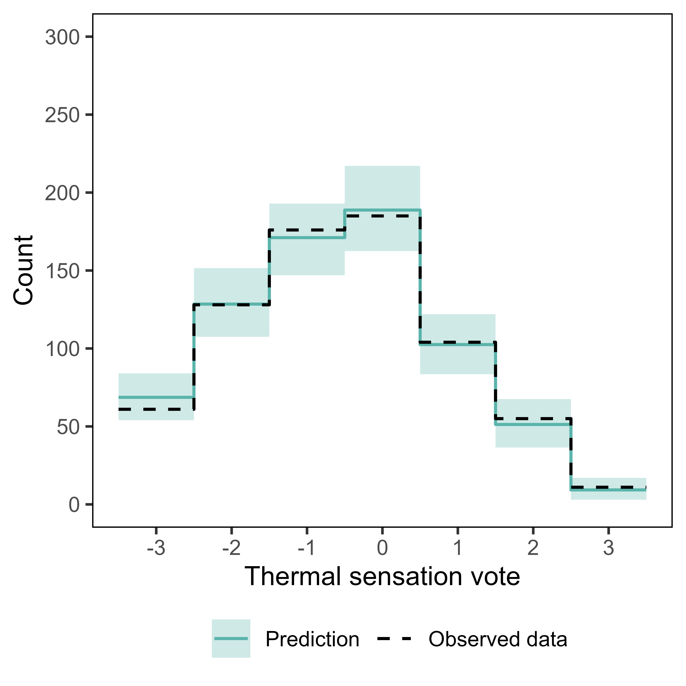
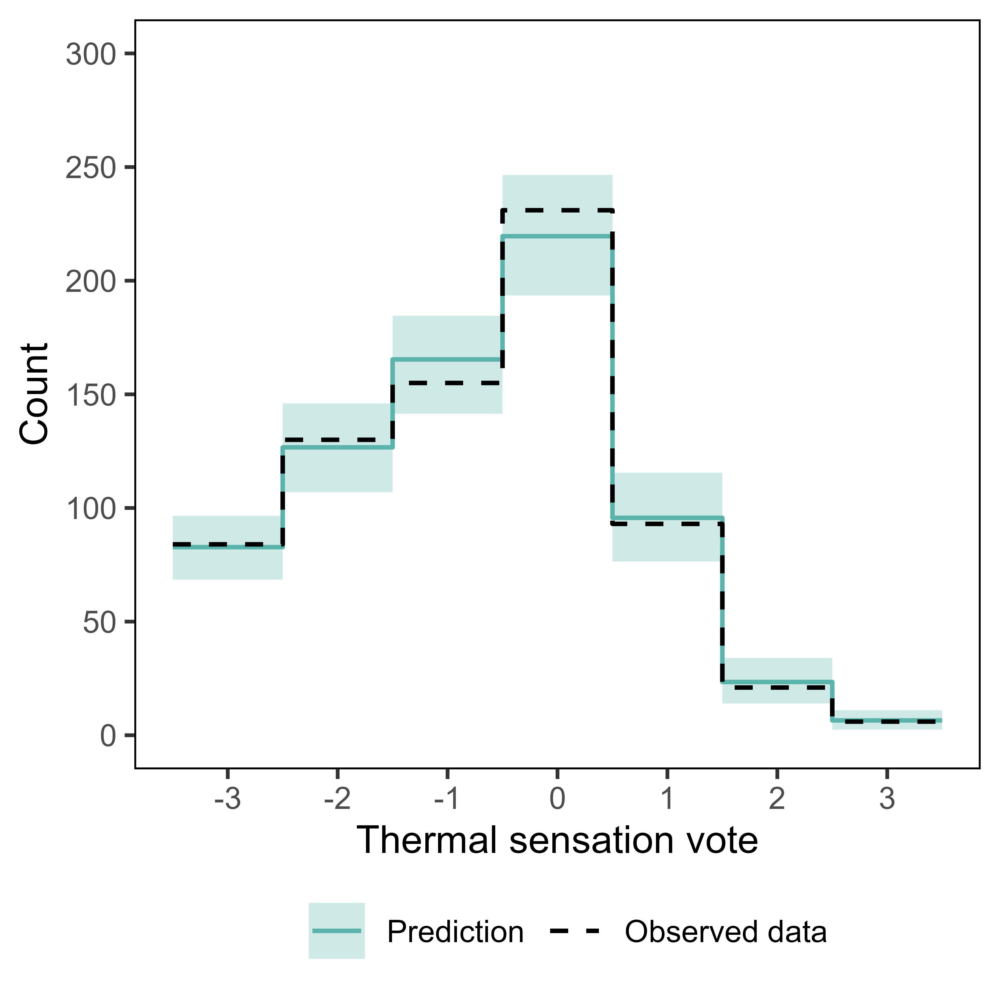
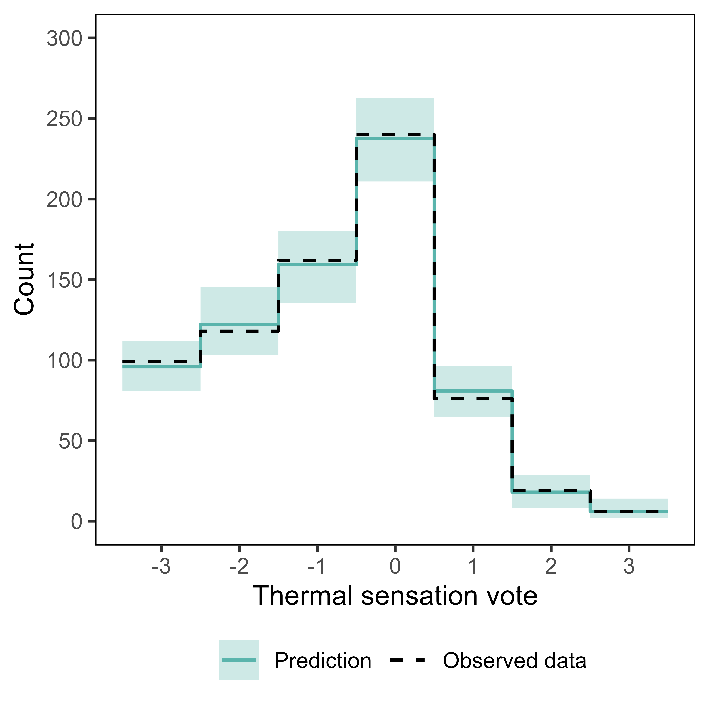
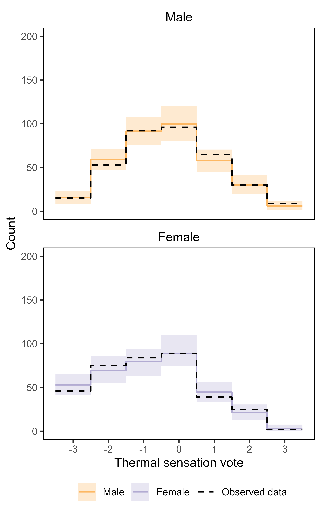
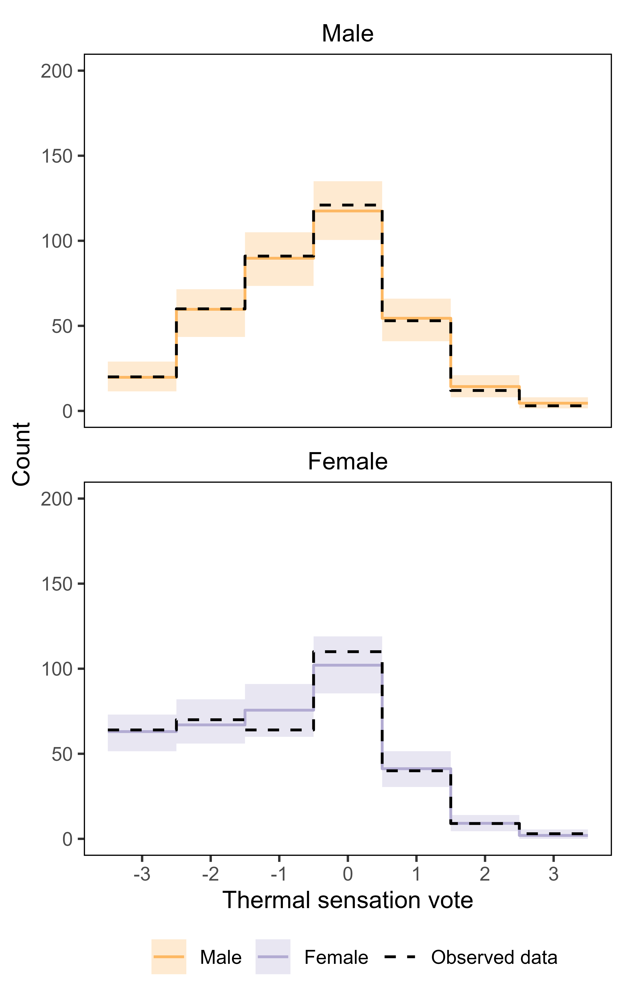
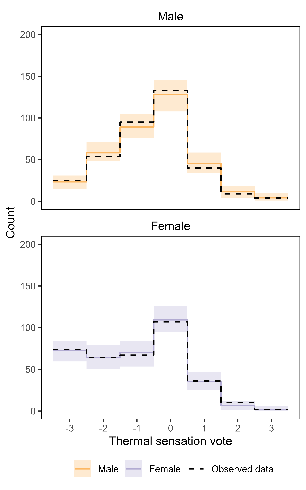
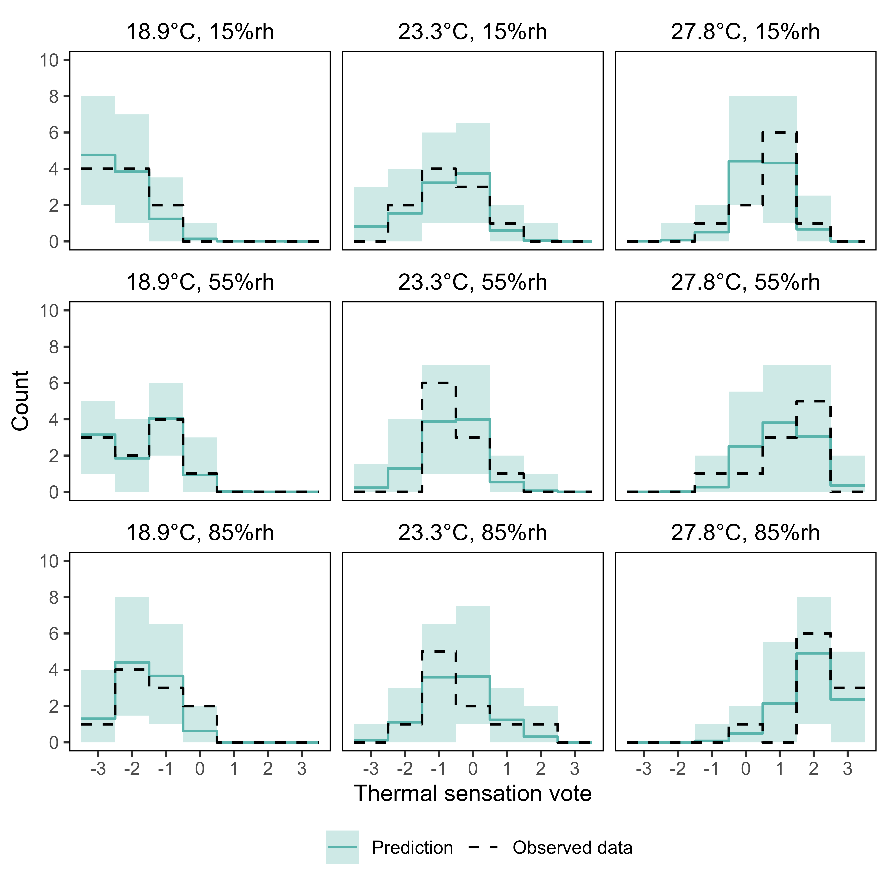
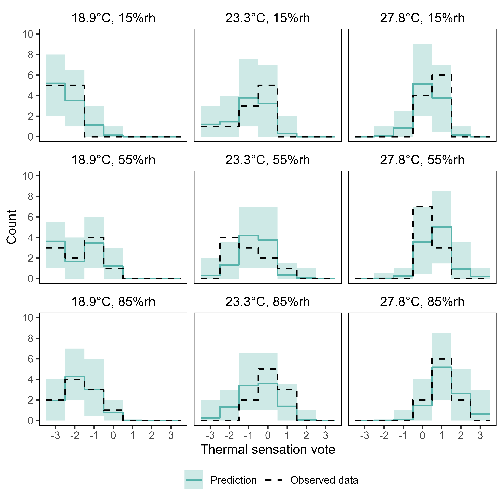
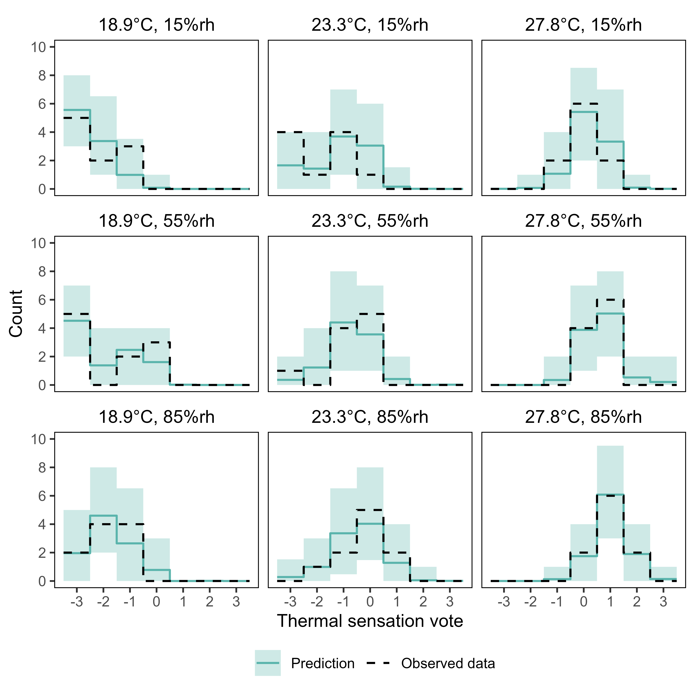

<nav class="supp-navbar">

<a href="javascript:history.back()" class="supp-back"> ‹ Back to Article </a>

</nav>

# Introduction

To evaluate the descriptive adequacy and predictive robustness of the Bayesian multilevel multinomial model, a series of posterior predictive checks (PPCs) were performed. These checks assess how well the model replicates the empirical distributions of the observed thermal sensation votes ($y$) by drawing 100 independent simulated datasets ($y_{rep}$) directly from the joint posterior distribution. Because the data were collected across a discrete factorial grid consisting of unique combinations of temperature and relative humidity levels model performance was systematically analysed across four decreasing levels of aggregation.

## All data, pooled across sex

The model’s overall performance was first assessed at the highest level of aggregation, pooling the simulated data across all participants, sexes, and unique environmental conditions. At this level, localised group-level variance averages out, revealing a near-perfect alignment between the empirical data and the model predictions. Every observed data point falls squarely within the tightest bounds of the 95% posterior predictive intervals. This demonstrates that the model accurately captures the population-wide baseline distribution of responses without exhibiting any systematic bias.

#### Posterior predictive checks for all data at one hour from onset, pooled across sex

```{r}
#| label: fig-post-check_all-data_onset-1h
#| fig-cap: "Posterior predictive checks for all data at one hour from onset, pooled across sex. Solid coloured lines represent posterior mean TSV estimates with shaded bands indicating the corresponding 95% credible intervals. Black dashed lines denote the observed TSV."
#| out-width: "60%"
#| echo: false

```

#### Posterior predictive checks for all data at two hours from onset, pooled across sex

```{r}
#| label: fig-post-check_all-data_onset-2h
#| fig-cap: "Posterior predictive checks for all data at two hours from onset, pooled across sex. Solid coloured lines represent posterior mean TSV estimates with shaded bands indicating the corresponding 95% credible intervals. Black dashed lines denote the observed TSV."
#| out-width: "60%"
#| echo: false

```

#### Posterior predictive checks for all data at three hours from onset, pooled across sex

```{r}
#| label: fig-post-check_all-data_onset-3h
#| fig-cap: "Posterior predictive checks for all data at three hours from onset, pooled across sex. Solid coloured lines represent posterior mean TSV estimates with shaded bands indicating the corresponding 95% credible intervals. Black dashed lines denote the observed TSV."
#| out-width: "60%"
#| echo: false

```

## All data, separated by sex

To ensure that the global fit did not mask structural disparities between groups, the simulated data were evaluated strictly by sex while remaining pooled across all unique environmental conditions. The model successfully reconstructs the distinct distributional profiles and subtle asymmetries of both the male and female cohorts. The empirical observations closely mirror the predicted modes and sit safely within the 95% highest density intervals across the entire thermal sensation scale. This confirms that the model parameters accurately accommodate sex-specific tendencies across the broader experimental landscape.

#### Posterior predictive checks for all data at one hour from onset, stratified by sex

```{r}
#| label: fig-post-check_all-data-by-sex_onset-1h
#| fig-cap: "Posterior predictive checks for all data at one hour from onset, stratified by sex. Solid coloured lines represent posterior mean TSV estimates for females (violet) and males (orange), with shaded bands indicating the corresponding 95% credible intervals. Black dashed lines denote the observed TSV."
#| out-width: "60%"
#| echo: false

```

#### Posterior predictive checks for all data at two hours from onset, stratified by sex

```{r}
#| label: fig-post-check_all-data-by-sex_onset-2h
#| fig-cap: "Posterior predictive checks for all data at two hours from onset, stratified by sex. Solid coloured lines represent posterior mean TSV estimates for females (violet) and males (orange), with shaded bands indicating the corresponding 95% credible intervals. Black dashed lines denote the observed TSV."
#| out-width: "60%"
#| echo: false

```

#### Posterior predictive checks for all data at three hours from onset, stratified by sex

```{r}
#| label: fig-post-check_all-data-by-sex_onset-3h
#| fig-cap: "Posterior predictive checks for all data at three hours from onset, stratified by sex. Solid coloured lines represent posterior mean TSV estimates for females (violet) and males (orange), with shaded bands indicating the corresponding 95% credible intervals. Black dashed lines denote the observed TSV."
#| out-width: "60%"
#| echo: false

```

## Selected conditions, pooled across sex

Performance was next evaluated at the specific environmental level by aggregating the simulations by unique condition cells, combining the data from both sexes to yield a total sample size of ten individuals per facet. Moving down to this discrete condition level exposes the higher sampling variance inherent to the distinct participant cohorts. Nevertheless, the stabilising effect of pooling ten individuals reveals strong model concordance; the observed step-functions closely track the predicted peaks across the discrete temperature and relative humidity matrix.

#### Posterior predictive checks for nine selected conditions at one hour from onset, pooled across sex

```{r}
#| label: fig-post-check_selected-conditions_onset-1h
#| fig-cap: "Posterior predictive checks for nine selected conditions at one hour from onset, pooled across sex. Solid coloured lines represent posterior mean TSV estimates with shaded bands indicating the corresponding 95% credible intervals. Black dashed lines denote the observed TSV."
#| out-width: "80%"
#| echo: false

```

#### Posterior predictive checks for nine selected conditions at two hours from onset, pooled across sex

```{r}
#| label: fig-post-check_selected-conditions_onset-2h
#| fig-cap: "Posterior predictive checks for nine selected conditions at two hours from onset, pooled across sex. Solid coloured lines represent posterior mean TSV estimates with shaded bands indicating the corresponding 95% credible intervals. Black dashed lines denote the observed TSV."
#| out-width: "80%"
#| echo: false


```

#### Posterior predictive checks for nine selected conditions at three hours from onset, pooled across sex

```{r}
#| label: fig-post-check_selected-conditions_onset-3h
#| fig-cap: "Posterior predictive checks for nine selected conditions at three hours from onset, pooled across sex. Solid coloured lines represent posterior mean TSV estimates with shaded bands indicating the corresponding 95% credible intervals. Black dashed lines denote the observed TSV."
#| out-width: "80%"
#| echo: false

```

## Selected conditions, separated by sex

Finally, the model was subjected to its most stringent descriptive test at the fully disaggregated level, separating the unique environmental conditions strictly by sex. At this highly granular level, the small sample size per cell introduces intense sampling variance, manifesting as sharp, irregular peaks in the raw data driven by the individual idiosyncrasies of those specific testing groups. Rather than overfitting to these localised fluctuations, the model utilises partial pooling to smooth out group-specific anomalies. Crucially, the observed frequencies almost universally reside within the model's wide predictive intervals, demonstrating that the hierarchical structure successfully regularises small-sample noise while preserving the generalised trajectory across the discrete experimental grid.

#### Posterior predictive checks for nine selected conditions at one hour from onset, stratified by sex

```{r}
#| label: fig-post-check_selected-conditions-by-sex_onset-1h
#| fig-cap: "Posterior predictive checks for nine selected conditions at one hour from onset, stratified by sex. Solid coloured lines represent posterior mean TSV estimates for females (violet) and males (orange), with shaded bands indicating the corresponding 95% credible intervals. Black dashed lines denote the observed TSV."
#| out-width: "80%"
#| echo: false
knitr::include_graphics("figures/post_check/posterior-check_selected-conditions-by-sex_onset-1h.png")
```

#### Posterior predictive checks for nine selected conditions at two hours from onset, stratified by sex

```{r}
#| label: fig-post-check_selected-conditions-by-sex_onset-2h
#| fig-cap: "Posterior predictive checks for nine selected conditions at two hours from onset, stratified by sex. Solid coloured lines represent posterior mean TSV estimates for females (violet) and males (orange), with shaded bands indicating the corresponding 95% credible intervals. Black dashed lines denote the observed TSV."
#| out-width: "80%"
#| echo: false
knitr::include_graphics("figures/post_check/posterior-check_selected-conditions-by-sex_onset-2h.png")
```

#### Posterior predictive checks for nine selected conditions at three hours from onset, stratified by sex

```{r}
#| label: fig-post-check_selected-conditions-by-sex_onset-3h
#| fig-cap: "Posterior predictive checks for nine selected conditions at three hours from onset, stratified by sex. Solid coloured lines represent posterior mean TSV estimates for females (violet) and males (orange), with shaded bands indicating the corresponding 95% credible intervals. Black dashed lines denote the observed TSV."
#| out-width: "80%"
#| echo: false
knitr::include_graphics("figures/post_check/posterior-check_selected-conditions-by-sex_onset-3h.png")
```
